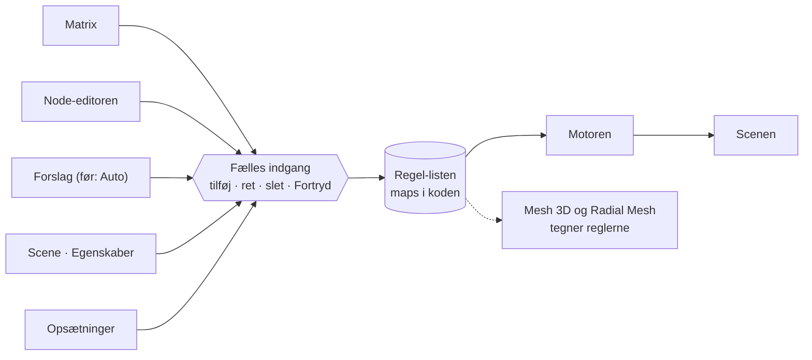
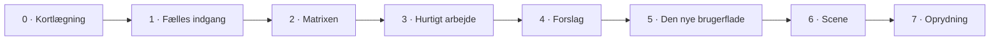

# PLAN · NY BRUGERFLADE · P8.1

*13. november 2026 · skrevet efter en gennemgang af `claude-mv-v9_42.html` · til brugeren og Claude Code · P8.1 afløser P8.0*

*Papirets versioner hedder P (fx P8.1). Programmets versioner hedder v (fx v9.42, v9.43). De to tællere har intet med hinanden at gøre.*

**Status: godkendt af brugeren den 13. november 2026**, bortset fra valg V3 (de gamle visninger), som stadig er et forslag. Intet er bygget.

**Nyt i P8.1:** matrixen åbner først, og en knap skifter til Node-editoren på samme vilkår (valg V1). Ingen gamle visninger fjernes nu (valg V3). Programmet skal tilpasse sig skærmen (afsnit 1.1). Der er flere måder at kopiere regler på (fase 3 og 4). Mine egne kælenavne er skiftet ud med rigtige navne.

Skitserne til planen ligger på lærredet: <https://claude.ai/artifact/Wbw4VJ8df6ZfEACJQq5YCy>

---

## 0 · Kort fortalt

- **Motoren bliver.** Lydanalysen, figurerne, Mesh 3D, Øjet, Radial Mesh, Live preview og testene røres ikke.
- **Reglerne får én fælles indgang** (fagudtryk: API). Alt, der laver, retter eller sletter en regel, går gennem det samme sted i koden.
- **Matrixen åbner først.** En knap skifter til Node-editoren. De to er ligestillede og viser de samme regler.
- **Auto bliver til forslag.** Intet skriver regler uden at spørge.
- **Fire arbejdsområder** (fagudtryk: workspaces) erstatter sidebjælken, bundbjælken, de 6 layouts og det at trække vinduer rundt.
- **Hvert trin fjerner noget**, og brugeren prøver hver version med musik, før det næste trin bygges.

---

## 1 · Regler for arbejdet (gælder foran alt andet i planen)

1. **Ét trin pr. "kør".** Code bygger ét trin, afleverer en version og stopper.
2. **Brugeren prøver med musik før næste trin.** Hvert trin har en lille opgave (brugertest). Code skriver, hvor mange klik opgaven tager. Brugeren svarer "ok" eller "ikke ok".
3. **Hvert trin fjerner noget.** Afleveringen viser tallene før og efter: knapper, vinduer og filens størrelse.
4. **Funktioner må forsvinde.** Reglen "ingen funktion må forsvinde" (funktionslisten, 106 af 106) gælder ikke længere. Det, der fjernes, er det, brugeren krydser af i fase 0. Koden ligger stadig i git-historikken.
5. **Ingen udvikler-tekst på skærmen.** Ingen trin-numre, versionsnumre på biblioteker, vinduesnumre eller "106 af 114". Den slags hører hjemme i Hjælp.

De faste regler i `CLAUDE.md` gælder stadig: test før aflevering, versionsnummer i filnavn, program og svar, manualen opdateres, og gamle gemte indstillinger skal kunne åbnes.

*Hvorfor regel 2 og 4:* fra 7. til 11. november blev der bygget 24 versioner (v9.19 til v9.42). Hver version bestod sine kodetest, men ingen blev prøvet med musik undervejs. Og fordi intet måtte forsvinde, kom indholdet af de fire slettede vinduer ind i Node-editoren igen (v9.39 og v9.41).

### 1.1 · Skærmstørrelse

Programmet bygges ikke til én bestemt skærmstørrelse. Det tilpasser sig det vindue, det får (fagudtryk: responsive layout).

1. **Mindste størrelser i stedet for faste størrelser.** En celle i matrixen bliver aldrig mindre end 44 × 40 punkter. På en større skærm ser man flere rækker og kolonner, ikke større celler.
2. **Én indstilling, der hedder Størrelse** (fagudtryk: UI scale), så brugeren selv kan gøre tekst og celler større eller mindre.
3. **Code prøver hver version i tre størrelser:** 1920 × 1080, 2560 × 1440 og 3840 × 2160.

Skitserne er tegnet i 2560 × 1440. Det var en antagelse i gennemgangen og ikke et valg.

---

## 2 · Det, gennemgangen fandt i v9.42

Tal mærket **målt** er talt i det kørende program i en testbrowser (2560 × 1440). Tal mærket **læst** er fundet i koden med scripts. Code skal tjekke dem i fase 0.

### 2.1 Det gode

- Programmet starter uden fejl, også med en sang, alle 6 layouts og 10 forudindstillinger (**målt**).
- Der findes allerede én liste med alle regler: `maps` (**læst**). Regel-lageret skal ikke opfindes.
- Kontrolpanelet for en regel er godt: en læselig sætning og skydere (**målt**). Det genbruges ved siden af matrixen.

### 2.2 Mapping

| Fund | Slags |
| --- | --- |
| Cirka 60 steder ændrer `maps` direkte (`maps = …`, `maps.push`, `maps.splice`, `maps.filter`) | læst |
| 64 steder kalder `renderMaps()` for at sige "reglerne er ændret". Glemmer ét sted det, viser skærmen noget forkert | læst |
| `renderMaps()` tegner stadig det slettede Mapping-vindue og har tre senere tilføjelser ovenpå (v9.12, v9.13, v9.15) | læst |
| En regel har intet id. Den kendes på kilde, mål og nummer. P7.7 har allerede bedt om et id | læst |
| En regels data ligger fire steder: selve reglen (`maps`), trim og gruppe-styrke (`scene.ne`), figur-styrke (på figuren) og nodens plads (`set.ne`) | læst |
| Node-editoren opdager ændringer ved at sammenligne en signatur igen og igen (fagudtryk: polling), fordi ingen siger til | læst |
| Styrken ganges i mindst 6 led: trim × regel × figur × samlet styrke × følsomhed × afsnits-dynamik | læst |

### 2.3 Auto

- Ordet "Auto" bruges om mindst 15 forskellige ting (**læst**). Listen står i fase 4.
- **Auto-mapping** (`autoSetup`) erstatter hele regel-listen (`maps = m`) og kender kun de gamle effekter (klodser, puls, glød, farve …), ikke figurerne. Med "Auto-mapping: Til" kører den igen ved hver ny sang, tre steder i koden. Den er slået fra fra start og kan fortrydes med Ctrl+Z (**læst**).
- Der er fem forskellige Fortryd: Ctrl+Z, Fortryd tilfældigt, Fortryd figurer, Fortryd sidste show og Fortryd for lys (**læst**).

### 2.4 Node-editoren

| Fund | Slags |
| --- | --- |
| Pigernes show: 37 regler, 14 lydtræk, 28 mål, 97 noder. Lærredet er 3.689 px højt ved 63 % zoom. Man ser 6 af de 37 regler ad gangen | målt |
| Alle regel-noder har samme titel ("Regel · Egenskab" eller "Regel · Handling"). Man skal følge linjerne for at se, hvad en regel gør | målt |
| I layoutet Overblik står zoom på 39 %, og teksten kan ikke læses | målt |
| Kontrolpanelet ligger oven på lærredet og dækker de nederste noder, til man flytter lærredet | målt |
| Tekst henviser til slettede vinduer: "Nr. 7 i Mapping", "Effekt-gruppe (fra Dublet)", "ændres her, i Mapping og i Router" | målt |
| Udvikler-tekst på skærmen: "Alle 16 trin er bygget (v9.19–v9.34)", "106 af 114", "three.js r186 ved siden af r128" | målt |
| Matrix findes under Visning ▾, men det er koden fra v3.4: den viser kun mål, der allerede har en regel, og fylder et lille hjørne. Ud fra koden kan man ikke lave en regel i en tom celle (ikke prøvet) | målt og læst |
| To udseender på samme skærm: Warm Analog (orange) inde i det blå glas | målt |

### 2.5 Vinduer, sidebjælke og topbar

- Docking (vinduessystem C) virker teknisk (**målt**).
- Der er fem veje til det samme vindue: sidebjælken, de 6 layout-knapper, fanerne, ＋ i zonen og Ctrl+K (**målt**).
- Flere vinduer har to titler: fanen og vinduets egen overskrift (fx Live preview og Node-editor) (**målt**).
- Rester af de ældre systemer ligger stadig i menuer og indstillinger: Zoner, Bredt skrivebord, Ordn vinduer, Minimér alle, Enkel tilstand (`set.zoner`, `set.bredt`, `set.lay3`, `set.enkel`) (**læst**).
- Niveau (sidebjælken) og Detaljer (Editoren) findes begge. Vinduesnummeret W6.1 står på skærmen (**målt**).
- 859 knapper, 112 skydere, 98 dropdowns og 28 vinduer i filen (**målt**). Den 30. oktober (v9.17) var der 862 knapper og 31 vinduer.

### 2.6 Editoren (figurer)

- I layoutet Figurer får Editoren 1077 × 1250 px, og det meste er tomt. Billedet af figuren er en smal stribe. Teksten på boksen "Scenen · træk prikken" er skåret af i Overblik ved 2560 × 1440 (**målt**).

### 2.7 Filen

- 6,2 MB. De 3,7 MB (60 %) er den nye three.js (r186), som kun bruges til linjerne i Node-editoren. Den gamle three.js (r128) fylder 0,6 MB. Programmets egen kode er cirka 1,2 MB i 110 blokke, de fleste opkaldt efter en version (**læst**).

### 2.8 Størrelsen på en matrix

- Der findes 116 lydtræk og, i Pigernes show, 224 mål (en danser har 81 egenskaber) (**målt**). Alt på én gang er cirka 26.000 celler. Matrixen skal derfor som standard kun vise det, der er i brug: 14 × 28 = 392 celler.
- 9 af de 26 forskellige figur-regler i Pigernes show er ens på de to piger (**målt**). "Kopiér regler fra figur til figur" sparer altså rigtigt arbejde.

---

## 3 · Valgene

| Nr. | Valg | Afgørelse | Status |
| --- | --- | --- | --- |
| V1 | Matrix og Node-editor | Matrixen åbner først. En knap skifter til Node-editoren, og de to er ligestillede (se fase 2, trin 2d). Editoren til figurer bygges om i fase 6 | Besluttet 13. nov. |
| V2 | Klodsbanen (fra rytmespillet) | Den bliver noget, man slår til i en scene. Gamle opsætninger beholder den | Valgt som anbefalet |
| V3 | De 10 gamle visninger | Ingen visning fjernes nu. Når matrixen er prøvet med musik (efter fase 3), tages de én ad gangen. Tidslinje bliver under alle omstændigheder. Den gamle Matrix-visning erstattes af den nye | **Forslag, venter på ja** |
| V4 | Udseende | Ét tema for hele programmet. Warm Analog først, de andre temaer senere | Valgt som anbefalet |
| V5 | Docking | Motoren bliver, men er låst som standard. Den kan låses op under Mere | Valgt som anbefalet |
| V6 | Versionsnummer for den nye brugerflade (fase 5) | Fortsæt v9.x. v10.0 er stadig gemt til senere | Valgt som anbefalet |

"Valgt som anbefalet" betyder, at brugeren skrev "ellers enig" den 13. november. Brugeren kan stadig ændre hvert af dem.

Til valg V3: hver visning svarer på ét spørgsmål. Tabellen viser, om den nye matrix kan svare på det samme.

| Visning | Spørgsmål | Kan den nye matrix svare på det? |
| --- | --- | --- |
| Tidslinje | Hvornår i sangen slår hver regel til? | Nej. Den er den eneste, der viser tid |
| Træ | Hvad påvirker lige præcis denne figur? | Delvist. Vejen fra lyd til figur ses ikke |
| Ring | Hvad hænger sammen på kryds og tværs? | Nej, men Radial Mesh viser næsten det samme |
| Matrix (den gamle) | Hvad bruges, og hvad bruges ikke? | Ja, den erstattes |
| Bue-diagram | Hvilke lyde deler de samme mål? | Ja. En kolonne med flere fyldte celler |
| Treemap | Hvor stor en del har hver figur? | Ja, hvis hver figur viser sit antal regler |
| Strømme | Hvor meget styrer hver lyd? | Ja, hvis hver række viser en sum |
| Hive plot | Hvordan fordeler reglerne sig? | Nej |
| Frit netværk | Hvad hører sammen i klynger? | Nej |
| 3D-netværk | Hvordan ser det ud i rummet? | Nej |

Den 30. oktober valgte brugeren Træ, Kolonner, Matrix, Tidslinje og Ring som de første fem.

---

## 4 · Faserne

### Fase 0 · Kortlægning (ingen kode ændres)

**Mål:** vide præcist, hvad der findes, og lade brugeren vælge, hvad der skal væk.

Code skriver `docs/KORTLAEGNING.md` med fem dele:

1. **Regler:** hvert sted, der ændrer `maps`, med blok og linje.
2. **Auto:** hver ting, der hedder Auto eller Automatisk, og hvad den ændrer.
3. **Fjerne-listen:** hvert vindue, hver visning og hver gruppe af knapper, nummereret, med en linje om, hvad den gør. Brugeren svarer med numre: "behold 1, 4, 9 · fjern 2, 3 · ved ikke 5".
4. **Rester:** død kode og indstillinger fra ældre vinduessystemer.
5. **Udgangspunkt:** antal knapper, skydere, dropdowns, vinduer og filens størrelse.

Code tjekker også tallene i afsnit 2 og skriver, hvor de ikke passer.

**Fjernes:** intet. **Model:** Fable 5.2.

### Fase 1 · Én fælles indgang til reglerne

**Mål:** ét sted i koden, som alt andet bruger til at lave, rette og slette regler. Skærmen ser ud som før.

- Ét objekt, fx `Regler`, med `alle()`, `find(id)`, `tilfoej(regel)`, `ret(id, felter)`, `slet(id)`, `erstat(liste)` og `lyt(funktion)`. Flere ændringer kan samles til ét Fortryd-skridt.
- **Et id på hver regel.** Gamle opsætninger uden id får et, når de åbnes. (Det samme som P7.7 punkt 3b.)
- **Ét Fortryd for alt:** også trim, effekt-gruppernes styrke, øje, Slå fra, Normalisering og Samlet styrke. (Det samme som P7.7 punkt 3a.)
- De cirka 60 steder flyttes til den fælles indgang i små bidder, fx 10 ad gangen. Efter hver bid: testen, der viser, at motoren regner præcis som før for alle forudindstillinger og de gamle gemte indstillinger.
- Trim, figur-styrke og kombination (Største, Læg sammen, Gang) læses og skrives gennem den fælles indgang. De bliver liggende, hvor de er gemt i dag.
- Node-editoren lytter på den fælles indgang i stedet for at sammenligne signaturer.

**Fjernes:** tegningen af det slettede Mapping-vindue i `renderMaps()` og dens tre tilføjelser.
**Færdig når:** en test viser, at ingen kode uden for den fælles indgang skriver til `maps`.
**Brugertest:** "Alt virker som før. Ret et trim, og fortryd med Ctrl+Z."
**Model:** Fable 5.2 til opbygningen, Opus 5.5 til flytningen.

*Fagudtryk:* en fælles indgang til data hedder et API eller en "store".

### Fase 2 · Matrixen

**Mål:** lave og rette regler hurtigt. Matrixen åbner først i Node-editorens fane, og en knap skifter mellem Matrix og Node-editor. Resten af brugerfladen ændres ikke endnu.

| Trin | Indhold |
| --- | --- |
| 2a · Se | Rækker = lydtræk i brug, i mapper efter musik (D2, som på lærredet i v9.42). Kolonner = mål i brug, i grupper pr. figur og effekt-gruppe. En celle med en regel viser styrken som højde og lyser, når reglen slår til. Klik vælger reglen og viser det nuværende kontrolpanel |
| 2b · Lav og ret | Klik i en tom celle laver en regel med standard-indstillinger (de samme, som et nyt link får i dag). Træk op og ned ændrer styrken. Delete sletter. M slår fra og til. Piletaster flytter valget |
| 2c · Find rundt | "+ lydtræk" og "+ mål" med søgning (genbrug listen fra Ctrl+K). Fold en figur sammen. Vis "Brugte" eller "Alle". Overskrifterne står fast, når man ruller |
| 2d · Samme vilkår | Matrix og Node-editor er ligestillede. Alt, hvad man kan gøre med en regel i den ene, kan man også i den anden: lave, rette, slå fra, slette og fortryde. Den valgte regel er stadig valgt, når man skifter. Hver regel-node får en titel, der siger, hvad reglen gør (fx "Snare → Arm venstre: løft"). Tekst, der henviser til slettede vinduer, og udvikler-tekst fjernes |

- Celler er mindst 44 × 40 px ved 100 %.
- En celle med flere regler viser et lille tal. En regel med Gate viser en lille prik.
- Matrixen tegnes uden den nye three.js.

**Fjernes:** den gamle Matrix-visning (v3.4).
**Brugertest:** "Indlæs Pigernes show. Få Pige på stangen til at løfte højre arm på vokalen." Code tæller klik i Node-editoren i dag og i matrixen.
**Model:** Opus 5.5.

### Fase 3 · Hurtigt arbejde

**Fem måder at kopiere på:**

| Måde | Eksempel |
| --- | --- |
| Kopiér og indsæt med Ctrl+C og Ctrl+V | Markér fire celler hos den ene pige, og indsæt dem hos den anden |
| Træk for at kopiere (hold Ctrl nede, og træk en celle hen på en anden) | Træk reglen fra "Hofte: svaj" over på "Hår: sving" |
| Kopiér en hel figurs regler til en anden figur (kun de egenskaber, begge har) | Pige på stangen får alle Lyshåret piges regler |
| Indsæt kun indstillingerne (fagudtryk: paste special) | Giv ti regler samme tærskel, attack og release uden at ændre, hvad de styrer |
| Spejl venstre og højre | Reglen for venstre arm kopieres til højre arm |

**Desuden:**

- Markér flere celler, og sæt samme tærskel eller styrke på dem alle.
- **Hele styrke-kæden kan ses i kanten:** trim på rækken, figurens styrke på gruppen, Største · Læg sammen · Gang på kolonnen og Samlet styrke i hjørnet.

**Senere, hvis brugeren savner det:** byt lydtræk for en hel række ("alt det, Kick styrer, skal Snare styre i stedet"), og lad en figur følge en anden (fagudtryk: link). Den sidste skal vises meget tydeligt, fordi intet må være skjult.

**Fjernes:** de tilsvarende dubletter i Node-editorens kontrolpanel.
**Brugertest:** "Giv Pige på stangen de samme regler som Lyshåret pige."
**Model:** Opus 5.5.

### Fase 4 · Forslag i stedet for Auto

**Mål:** intet skriver regler uden at spørge, og alt automatisk kan ses ét sted.

| Slags | Ting fundet i v9.42 | Bliver til |
| --- | --- | --- |
| Skriver regler | Auto-mapping (Kør og Til/Fra), Auto-kobl, Dansemapping, diskokuglens kobling, Lav show (Rolig, Balanceret, Vild), Tilfældigt, Figur-generatorens kobling, skabeloner, Tilføj morgenstjerne, udfyldning af klods-spor | **Forslag:** stiplede celler i matrixen. Ja eller nej, én ad gangen eller alle. Sletter aldrig noget |
| Vælger en måling | Taktslag Auto · Manuel, Spor Auto (4 spor), Auto-valg på en regel, Normalisering Adaptiv · Fast, Adaptiv tærskel | Bliver. Vises i panelet **Automatik**, hvor hver kan slås fra, og én knap giver standard tilbage |
| Visning og ydelse | Automatisk skarphed, Linjer: Auto, Skjul topbar automatisk, Random alt: skift automatisk, Program auto, Morph Pad auto | Flyttes til Indstillinger og hedder ikke længere Auto |

- Forslag kender figurerne på scenen.
- **Gem et sæt regler under et navn** (fagudtryk: preset), fx "Danser, rolig". Sættet kan bruges på nye figurer og i andre opsætninger, og det kommer ind som forslag.
- Ordet **Auto** bruges herefter kun om valg af måling.

**Fjernes:** "Auto-mapping: Til/Fra" (at den kører selv ved ny sang) og de fire ekstra Fortryd-knapper.
**Brugertest:** "Indlæs Pigernes show. Bed om forslag. Tjek, at ingen af pigernes regler er væk."
**Model:** Opus 5.5.

### Fase 5 · Den nye brugerflade

**Mål:** én vej til hver ting.

- **Én linje øverst:** de fire arbejdsområder · afspilning, tid, tempo og toneart · Søg (Ctrl+K), Fortryd, Gem og Mere.
- **Fire arbejdsområder** (tasterne 1 til 4):

| Arbejdsområde | Indhold | Bag knappen Mere |
| --- | --- | --- |
| 1 · Sang | Lydkilde, Tidslinje, Analyse, EQ og EQ+ | Generator, Lydlag, Lydtræk-guide |
| 2 · Scene | Live preview, Mesh 3D, Øjet, Radial Mesh, figurliste, Egenskaber, Idé-galleri | Bane og klods, Kvalitet |
| 3 · Regler | Matrix og Node-editor (en knap skifter), lille Live preview, Reglen | Automatik |
| 4 · Show | Scenen i fuld størrelse, afsnit, Opsætninger, fuld skærm, projektor, optag | Preset som tekst |

- Det, brugeren har krydset af som "fjern" i fase 0, får ingen plads.
- EQ-visningens grafik ændres ikke.

**Fjernes:** sidebjælken, bundbjælken, de 6 layout-knapper, Niveau, vinduesnumre, udvikler-tekst og resterne af Zoner, Bredt skrivebord og Enkel tilstand.
**Brugertest:** "Fra programmet åbner, til pigerne danser til din egen sang: hvor mange klik?"
**Model:** Fable 5.2 til opdelingen, Opus 5.5 til byggeriet.

### Fase 6 · Scene

**Mål:** bygge figurer, som etablerede programmer gør det: liste til venstre, stor scene i midten, egenskaber til højre (fagudtryk: outliner, viewport og inspector, som i Blender, Unity og Figma).

- Editoren bliver panelet **Egenskaber** for den valgte figur.
- Man trækker i figurerne direkte i scenen (håndtagene findes allerede).
- Fanen Koblinger bliver til knappen **Vis i matrix**, som åbner Regler med kun den figur.
- Levende figurer og Morgenstjernen må ikke ændre opførsel. De får deres egne test.

**Fjernes:** fanen Koblinger og Detaljer-niveauerne.
**Brugertest:** "Lav en ny figur, sæt den på scenen, og giv den to regler."
**Model:** Opus 5.5.

### Fase 7 · Oprydning

- Det, der står som "fjern" på listen fra fase 0, tages ud af programmet.
- De gamle visninger tages én ad gangen efter valg V3.
- Klodsbanen efter valg V2.
- Blokkene i koden får navn efter, hvad de gør, ikke efter version.
- Den nye three.js vurderes: den er vejen til WebGPU for Mesh 3D og Øjet, så den bliver, hvis den plan stadig gælder.

**Model:** Opus 5.5.

---

## 5 · Det, der ikke må ændres

- EQ-visningens grafik. Nye EQ-ting kommer som noget ekstra.
- Levende figurer og Morgenstjernen.
- Mesh 3D, Radial Mesh, Øjet og Live preview er programmets hovedattraktioner.
- Motoren skal regne præcis som før (testene findes).
- Gamle gemte indstillinger skal kunne åbnes (test 12).
- Grundreglen: "Jeg skal kunne forstå, hvad der sker, uden at noget er skjult."

---

## 6 · Model i Claude Code

| Arbejde | Model |
| --- | --- |
| Fase 0: kortlægning af hele koden | Fable 5.2 |
| Fase 1: opbygningen af den fælles indgang til reglerne | Fable 5.2 |
| Fase 5: opdelingen i arbejdsområder | Fable 5.2 |
| Alt byggeri, fejlretning, test og manual | Opus 5.5 |
| Opus kører fast i den samme fejl to gange | Skift til Fable 5.2 for den ene opgave |

Modellen skiftes med `/model`. Fable koster det dobbelte pr. token og bruger derfor kvoten hurtigere end Opus.

---

## 7 · Forholdet til P7.7 og hovedchatten

- `NODE-EDITOREN.md` (P7.7) beskriver stadig, hvordan Node-editoren virker. P8.1 bestemmer rækkefølgen og hvad der fjernes. Hvor de to er uenige, gælder P8.1.
- P7.7 punkt 3 (Fortryd for resten og et fast id) er første del af fase 1 her. Er det allerede bygget, krydses det af.

---

## 8 · Ikke testet og usikkert

- Gennemgangen er lavet i en testbrowser uden grafikkort. Hastighed, WebGPU og den rigtige 43" skærm er ikke prøvet.
- Testpakken blev kun kørt delvist under gennemgangen. Del 1 til 9 kørte: Syntaks, Indhold, Browser, Router-motoren, Spærretid, Lydkort fjernet og Kilder og stereo bestod. Lydmotor 2 stoppede på et skærmbillede, der tog for lang tid (9 ok, 1 stoppet), sandsynligvis fordi testbrowseren her er langsom. Del 10 til 37 blev ikke kørt. Code skal køre hele pakken i fase 0.
- Programmet er kun prøvet med testsangen (30 sekunder, 120 BPM), ikke med rigtig musik.
- Lydmotoren, Mesh 3D og Øjet er ikke læst igennem. De er kun set køre uden fejl.
- Tallene mærket **læst** er talt med scripts og kan være lidt ved siden af.
- Skitserne er tegninger. Ingen af dem er bygget eller prøvet.
