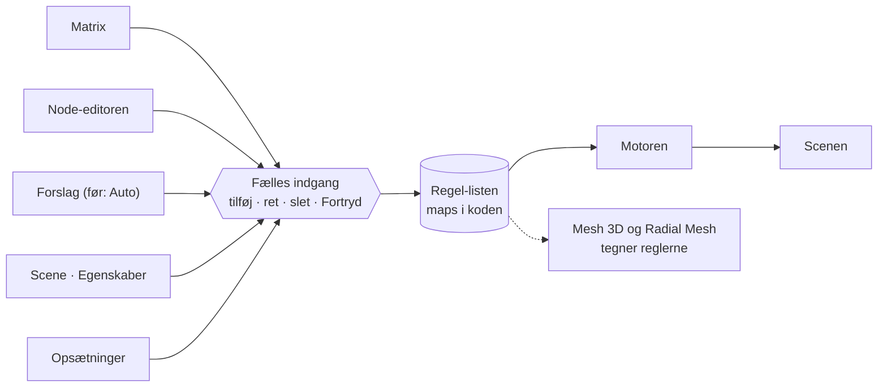
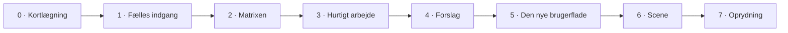

# PLAN · NY BRUGERFLADE · P8.9

*13. november 2026 · skrevet efter en gennemgang af `claude-mv-v9_42.html` · til brugeren og Claude Code · P8.2 afløser P8.1*

*Papirets versioner hedder P (fx P8.1). Programmets versioner hedder v (fx v9.42, v9.43). De to tællere har intet med hinanden at gøre.*

**Status: godkendt af brugeren den 13. november 2026.** Alle valg er afgjort, også V3. Fase 0 (kortlægning) er lavet: `docs/KORTLAEGNING.md`. Intet er bygget.

**Nyt i P8.9** (skrevet ind af Claude Code efter brugerens besked 19. november, `docs/arkiv/BESKED-TIL-CODE-19-nov-P8_9.txt`; P8.7 og P8.8 blev ikke sendt): **valg C** for regel-sæt i Biblioteket (retter B3 og B4: regel-sæt vises kun hos de figurer, de passer til; intet afsnit "Til alle figurer"); **svarene på fase 7** (a: ingen gamle visninger fjernes, fast regel i V3; b: Ikke i brug (parkér) erstattes af Slå fra på lydtræk-rækken i matrixen; c: Kort over forbindelserne bliver og lægges i værktøjslinjen fra B5; d: Lydmotor Klassisk fjernes) er bygget som **et lille trin for sig før pakke 7 (v9.84)**; et eget oprydningstrin efter pakke 7 står under *Senere*. B6 venter stadig på navnene.

**Nyt i P8.6** (skrevet ind af Claude Code efter brugerens besked 19. november, `docs/arkiv/BESKED-TIL-CODE-19-nov-P8_6.txt`; overblik med tegninger: <https://claude.ai/artifact/6AgywiURk8BpvQ6hLw3rEz>): **pakke 7 · Biblioteket** (B1–B6) er den næste pakke efter pakke 6 (afsnit 1.2 og det nye afsnit 4.1); beslutningerne om Figur-generatoren (6c) står i fase 6; nye 2D-figurer, en 3D-scene og analysen står under *Senere*. Pakke 6 er bygget (v9.81–v9.83). Intet fra punkt 3–6 i beskeden bygges nu.

**Nyt i P8.3** (rettet af Claude Code efter brugerens besked 16. november, `docs/arkiv/BESKED-TIL-CODE-16-nov-pakker.txt`): resten af trinene er samlet i seks pakker (afsnit 1.2), og reglen "ét trin pr. kør" er afløst af "én pakke pr. kør". Fase 1 og 2 er færdige (v9.43–v9.55), og fase 3 trin 3a er lavet (v9.56). Stregerne i Node-editoren (brugerens billede 15. november og konsol-linjen om NaN i stregernes geometri) tages for sig og er ikke med i pakkerne.

**Nyt i P8.2** (rettet af Claude Code efter brugerens svar på fase 0, 13. november): tallene i afsnit 2 er rettet efter kortlægningen (afsnit f); valg V3 er afgjort; brugerens svar på fjerne-listen står i afsnit 3.1; Morph Pad fjernes helt; de seks ting, der manglede i fase 4, står i tabellen dér; Radial Mesh' rejsende lys står i afsnit 5. Intet andet er ændret.

**Nyt i P8.1:** matrixen åbner først, og en knap skifter til Node-editoren på samme vilkår (valg V1). Ingen gamle visninger fjernes nu (valg V3). Programmet skal tilpasse sig skærmen (afsnit 1.1). Der er flere måder at kopiere regler på (fase 3 og 4). Mine egne kælenavne er skiftet ud med rigtige navne.

Skitserne til planen ligger på lærredet: <https://claude.ai/artifact/Wbw4VJ8df6ZfEACJQq5YCy>

---

## 0 · Kort fortalt

- **Motoren bliver.** Lydanalysen, figurerne, Mesh 3D, Øjet, Radial Mesh, Live preview og testene røres ikke.
- **Reglerne får én fælles indgang** (fagudtryk: API). Alt, der laver, retter eller sletter en regel, går gennem det samme sted i koden.
- **Matrixen åbner først.** En knap skifter til Node-editoren. De to er ligestillede og viser de samme regler.
- **Auto bliver til forslag.** Intet skriver regler uden at spørge.
- **Fire arbejdsområder** (fagudtryk: workspaces) erstatter sidebjælken, bundbjælken, de 6 layouts og det at trække vinduer rundt.
- **Hvert trin fjerner noget**, og brugeren prøver hver version med musik, før det næste trin bygges.

---

## 1 · Regler for arbejdet (gælder foran alt andet i planen)

1. **Én pakke pr. "kør"** (P8.3; før: ét trin pr. "kør"). Code bygger alle trin i pakken. Hvert trin får stadig sit eget versionsnummer, sin egen test og sit eget gem. Code stopper midt i en pakke, hvis en test fejler og ikke kan rettes sikkert, eller hvis et trin kræver et valg fra brugeren. Pakkerne står i afsnit 1.2.
2. **Brugeren prøver den sidste version i pakken med musik** (P8.3; før: hver version). Afleveringen har en kort liste over, hvad der skal prøves for hvert trin. Brugeren svarer "ok" eller "ikke ok".
3. **Hvert trin fjerner noget.** Afleveringen viser tallene før og efter: knapper, vinduer og filens størrelse.
4. **Funktioner må forsvinde.** Reglen "ingen funktion må forsvinde" (funktionslisten, 106 af 106) gælder ikke længere. Det, der fjernes, er det, brugeren krydser af i fase 0. Koden ligger stadig i git-historikken.
5. **Ingen udvikler-tekst på skærmen.** Ingen trin-numre, versionsnumre på biblioteker, vinduesnumre eller "106 af 114". Den slags hører hjemme i Hjælp.

De faste regler i `CLAUDE.md` gælder stadig: test før aflevering, versionsnummer i filnavn, program og svar, manualen opdateres, og gamle gemte indstillinger skal kunne åbnes.

*Hvorfor regel 2 og 4:* fra 7. til 11. november blev der bygget 24 versioner (v9.19 til v9.42). Hver version bestod sine kodetest, men ingen blev prøvet med musik undervejs. Og fordi intet måtte forsvinde, kom indholdet af de fire slettede vinduer ind i Node-editoren igen (v9.39 og v9.41).

### 1.2 · Pakkerne (P8.3, brugerens besked 16. november)

| Pakke | Trin | Brugeren prøver | Status |
| --- | --- | --- | --- |
| **1 · resten af fase 3** | **3b** træk med Ctrl for at kopiere en celle; indsæt kun indstillingerne. **3c** kopiér en hel figurs regler til en anden figur med én knap; spejl venstre og højre. **3d** styrke-kæden i kanten af matrixen (trim på rækken, figurens styrke på gruppen, Største · Læg sammen · Gang på kolonnen, Samlet styrke i hjørnet); dubletterne i Node-editorens kontrolpanel fjernes | Giv Pige på stangen de samme regler som Lyshåret pige | bygget (v9.57, v9.58, v9.59); venter på brugerens prøve |
| **2 · fase 4** | **4a** Auto-mapping bliver til "Foreslå regler" (stiplede celler, ja eller nej, én ad gangen eller alle; kender figurerne; sletter intet; brug Audits beregning, hvis den hjælper); "Auto-mapping: Til/Fra" fjernes. **4b** de andre, der skriver regler, bliver til forslag (Auto-kobl, Dansemapping, diskokuglens kobling, Lav show, Tilfældigt, skabeloner, Tilføj morgenstjerne, udfyldning af klods-spor); "Random alt: skift automatisk" og de fire ekstra Fortryd-knapper fjernes. **4c** panelet Automatik (Taktslag Auto, Spor Auto, Auto-valg, Normalisering, Adaptiv tærskel, Sektionernes vægte: kan ses og slås fra, én knap giver standard); gem et sæt regler under et navn; det, der kun handler om visning, flyttes til Indstillinger og hedder ikke Auto | Indlæs Pigernes show, bed om forslag, og tjek, at ingen af pigernes regler er væk | bygget (v9.63, v9.64, v9.65); venter på brugerens prøve. Ikke lavet: Lav show som forslag; visnings-automatik til Indstillinger |
| **3 · fase 5, første del** (Fable 5.2 til opdelingen) | **5a** én linje øverst og de fire arbejdsområder Sang, Scene, Regler og Show (tasterne 1 til 4); det gamle må gerne ligge der endnu. **STOP:** brugeren skal se opdelingen, før mere bygges | Se den nye opdeling | bygget (v9.67); STOPPET, venter på brugeren. "Én linje øverst" er kun lavet som fire knapper i den gamle topbjælke |
| **4 · fase 5, resten** | **5b** fjern sidebjælken, bundbjælken, de 6 layout-knapper, Mine layouts, Niveau, vinduesnumre, Enkel tilstand og resterne af Zoner og Bredt skrivebord; ryd Mere-menuen; docking låst som standard. **5c** ét tema i hele programmet (Warm Analog først); indstillingen Størrelse; Indstillinger samlet ét sted | Fra programmet åbner, til pigerne danser til brugerens egen sang; tæl klik | bygget (v9.71, v9.72); venter på brugerens prøve. Warm Analog er en første gennemgang (faste farver inde i enkelte vinduer er ikke gået efter) |
| **5 · fase 6** | **6a** figurliste til venstre, stor scene i midten, Egenskaber til højre; træk i figurerne direkte i scenen. **6b** fanen Koblinger bliver til knappen "Vis i matrix"; Detaljer-niveauerne, Adfærd (nr. 74) og kilde-dropdown ved hver egenskab (nr. 77) fjernes. **6c** ny Figur-generator: **VENT**, til brugeren har sendt en skitse. Beslutninger (P8.6): den skal kunne lave både abstrakte figurer og karakterer (piger, dansere og de nye figurer); to veje ind: fra lyden (standard: vælg en lyd, få forslag) og fra figuren; forslagene vises som et galleri med 6 små levende forslag, klik giver "flere som denne", og man kan låse ting (fx farven); hvor generatoren bor, bestemmer Code. Levende figurer og Morgenstjernen må ikke ændre opførsel | Lav en ny figur, sæt den på scenen, og giv den to regler | 6a bygget (v9.74), 6b bygget (v9.75); 6c venter på skitsen |
| **6 · fase 7** | **7a** fjern det, der står som "fjern" i afsnit 3.1 og endnu ligger der (fx Lyd i 3D, Idé-galleri, Generator (fuld), Lydlag, Detektion, Audit-vinduet, scene-nodens knapper og Fest); behold Audits beregning. **7b** klodsbanen bliver noget, man slår til i en scene (valg V2). **7c** død kode fjernes, blokkene får navn efter, hvad de gør; den nye three.js vurderes; vis filens størrelse før og efter. De gamle visninger: spørg om én ad gangen, fjern ingen uden brugerens ja |  | bygget (v9.81, v9.82, v9.83). 7c: Lyd i 3D, Idé-galleri, Enkel tilstand og Mappings rester er ude af filen; blokkene har ikke fået nye navne (13 test finder dem på navnet); three.js: valg A står ved magt. De gamle visninger, Ikke i brug (parkér), Kort over forbindelserne og Lydmotor Klassisk er **ikke rørt** (brugeren spørges) |
| **7 · Biblioteket** (P8.6, 19. november) | **B1** ryd op og beskyt: test, der beskytter alt indbygget; trommeslageren fjernes (showet Trommeslagerens solo, figur-skabelonen og knappen Eksempel: trommeslager); kun 10 opsætninger bliver (piger_show, danser_show, ms_show, dronning_show, singlen, auto1–3, spilselv, klaverspil), de andre 23 fjernes, efter at det, koden bruger (fx `vis` i Nulstil, `lavRandom` i Tilfældigt), er flyttet; undersøg, om Lyt til sangen (auto1–3) og Lav show gør næsten det samme (fjern intet, skriv svaret). **B2** startskærm med Fortsæt · Start et show · Byg selv (tomt); linjen "Indlæst: … · n figurer · n regler" eller "Tomt", "· ændret" når et show fra Mine er ændret; beforeunload kun ved "ændret". **B3** vinduet Biblioteket i 3 · Regler ved siden af matrixen og Node-editoren: to hylder, Shows (de 10 + Mine + Sangens show) og Figurer (udseende og regel-sæt; "Til alle figurer"); kort med mærket Indbygget (låst) eller Mit (omdøb, slet); Brug · Vis reglerne · Lav en kopi; Fortryd tager af i ét trin; Opsætning 1–20 bliver en liste under Mine uden loft, pladserne flyttes over. **B4** alle figurer ligestillet: Morgenstjernen er en almindelig figur (knappen Tilføj morgenstjerne væk); de 6 regel-skabeloner fordeles på figurerne og "Til alle figurer"; Dansemapping bliver et indbygget regel-sæt under danseren (lægges aldrig på af sig selv; må ikke ændres). **B5** én værktøjslinje over matrixen og Node-editoren: Matrix · Node-editor · Foreslå regler · Lav show · Tilfældigt · Gem som regel-sæt (alle giver forslag). **B6** 5 regel-sæt pr. figur: **SENERE**, først når brugeren har godkendt navnene (forslag: Rolig, Energisk, På trommerne, På vokalen, Hele bandet). **Valg C (P8.9) retter B3 og B4:** når en figur er valgt i Biblioteket, står figurens egne regel-sæt øverst, og under dem de fælles regel-sæt, der også passer til netop den figur, med et lille mærke *fælles*; regel-sæt, der ikke passer, vises slet ikke; der er **ikke** et afsnit "Til alle figurer" (et fælles regel-sæt findes kun i én udgave, men vises hos hver figur, det passer til); et regel-sæt passer, når figuren har alle de egenskaber, det styrer (en pige har arme, discokuglen ikke); navnet "regel-sæt" bliver | Start programmet, vælg Start et show, se hvad der er indlæst, brug et regel-sæt på en figur og fortryd | i gang (brugerens "kør" 19. november); v9.84 (svar a–d) ligger foran. B1 bygget (v9.85), B2 bygget (v9.86), B3 bygget (v9.87), B4 bygget (v9.88), B5 bygget (v9.89), B6 bygget (v9.90) med navnene fra P8.6. **Pakke 7 er færdig** |

Brugerens svar (P8.9, 19. november) på de tre "ved ikke": Ikke i brug (parkér) fjernes og erstattes af Slå fra på lydtræk-rækken; Kort over forbindelserne bliver (lægges i værktøjslinjen fra B5); Lydmotor Klassisk fjernes, og Lydmotor 2 hedder bare Lydmotor. Bygget i v9.84 som et lille trin for sig før pakke 7. Code må dele et trin i to, hvis det bliver for stort, men siger det først.

### 1.1 · Skærmstørrelse

Programmet bygges ikke til én bestemt skærmstørrelse. Det tilpasser sig det vindue, det får (fagudtryk: responsive layout).

1. **Mindste størrelser i stedet for faste størrelser.** En celle i matrixen bliver aldrig mindre end 44 × 40 punkter. På en større skærm ser man flere rækker og kolonner, ikke større celler.
2. **Én indstilling, der hedder Størrelse** (fagudtryk: UI scale), så brugeren selv kan gøre tekst og celler større eller mindre.
3. **Code prøver hver version i tre størrelser:** 1920 × 1080, 2560 × 1440 og 3840 × 2160.

Skitserne er tegnet i 2560 × 1440. Det var en antagelse i gennemgangen og ikke et valg.

---

## 2 · Det, gennemgangen fandt i v9.42

Tal mærket **målt** er talt i det kørende program i en testbrowser (2560 × 1440). Tal mærket **læst** er fundet i koden med scripts. Code har tjekket dem i fase 0 (`docs/KORTLAEGNING.md`, afsnit f). Hvor Code fik et andet tal, står der **rettet i P8.2**. To tal er ikke tjekket; det står ved dem.

### 2.1 Det gode

- Programmet starter uden fejl, også med en sang, alle 6 layouts og alle **34** forudindstillinger (**målt**; rettet i P8.2: gennemgangen skrev 10, men der findes 34, og testpakken kører dem alle). Det starter også uden fejl i 1920 × 1080 og 3840 × 2160.
- Der findes allerede én liste med alle regler: `maps` (**læst**). Regel-lageret skal ikke opfindes.
- Kontrolpanelet for en regel er godt: en læselig sætning og skydere (**målt**). Det genbruges ved siden af matrixen.

### 2.2 Mapping

| Fund | Slags |
| --- | --- |
| **65 steder** ændrer `maps` direkte (`maps = …`, `maps.push`, `maps.splice`, `maps.filter`). Scriptet finder 69, men 3 er en lokal liste med samme navn, og 1 er oprettelsen ved start. Dertil kommer 59 skrivninger til et felt på en regel, fordelt på 33 funktioner (rettet i P8.2: før "cirka 60") | læst |
| 64 steder kalder `renderMaps()` for at sige "reglerne er ændret". Glemmer ét sted det, viser skærmen noget forkert | læst |
| `renderMaps()` tegner stadig det slettede Mapping-vindue og har tre senere tilføjelser ovenpå (v9.12, v9.13, v9.15) | læst |
| En regel har intet id. Den kendes på kilde, mål og nummer. P7.7 har allerede bedt om et id | læst |
| En regels data ligger fire steder: selve reglen (`maps`), trim og gruppe-styrke (`scene.ne`), figur-styrke (på figuren) og nodens plads (`set.ne`). Samlet styrke og Normalisering er et femte sted (rettet i P8.2) | læst |
| Node-editoren opdager ændringer ved at sammenligne en signatur igen og igen (fagudtryk: polling), fordi ingen siger til | læst |
| Styrken ganges i mindst 6 led: trim × regel × figur × samlet styrke × følsomhed × afsnits-dynamik | læst |
| Morph Pad erstatter hele regel-listen igen og igen, mens pucken bevæger sig (`mmpBlTrin`). Ctrl+Z gemmer og gendanner hele listen (`feGendan`), så et id pr. regel skal passe sammen med det (tilføjet i P8.2) | læst |

### 2.3 Auto

- Ordet "Auto", eller noget, der sker af sig selv, findes **36 steder**: 19 skriver regler, 6 vælger en måling, og 11 er visning og ydelse (**læst**; rettet i P8.2: før "mindst 15"). Listen står i fase 4 og i kortlægningens afsnit b.
- **Auto-mapping** (`autoSetup`) erstatter hele regel-listen (`maps = m`) og kender kun de gamle effekter (klodser, puls, glød, farve …), ikke figurerne. Med "Auto-mapping: Til" kører den igen ved hver ny sang, tre steder i koden. Den er slået fra fra start og kan fortrydes med Ctrl+Z (**læst**).
- Der er **seks** forskellige Fortryd: Ctrl+Z, Fortryd tilfældigt, Fortryd figurer, Fortryd sidste show, Fortryd for lyset i Mesh 3D og Fortryd for lyset i Øjet (**læst**; rettet i P8.2: før fem).

### 2.4 Node-editoren

| Fund | Slags |
| --- | --- |
| Pigernes show: 37 regler, 14 lydtræk, 28 mål, 97 noder. Lærredet er 3.689 px højt ved 63 % zoom. Man ser 5 hele regler af de 37 ad gangen (rettet i P8.2: før 6; Code målte 3.691 px ved 62,6 %) | målt |
| Alle regel-noder har samme titel ("Regel · Egenskab" eller "Regel · Handling"). Man skal følge linjerne for at se, hvad en regel gør | målt |
| I layoutet Overblik står zoom på 39 %, og teksten kan ikke læses. Ved 1920 × 1080 er det 28 %, ved 3840 × 2160 er det 61 % (tilføjet i P8.2) | målt |
| Kontrolpanelet ligger **under** lærredet, ikke oven på det, men det tager pladsen: med en regel valgt er panelet 213 px højt, og lærredet bliver tilsvarende lavere, så man ser færre noder (rettet i P8.2: før "ligger oven på lærredet") | målt |
| Tekst henviser til slettede vinduer: "Nr. 7 i Mapping", "Effekt-gruppe (fra Dublet)", "ændres her, i Mapping og i Router" | målt |
| Udvikler-tekst på skærmen: "Alle 16 trin er bygget (v9.19–v9.34)", "106 af 114", "three.js r186 ved siden af r128" og "Node-editoren · docking og fuld skærm" (den sidste tilføjet i P8.2) | målt |
| Matrix findes under Visning ▾, men det er koden fra v3.4: den viser kun mål, der allerede har en regel, og fylder et lille hjørne. Ud fra koden kan man ikke lave en regel i en tom celle (ikke prøvet) | målt og læst |
| To udseender på samme skærm: Warm Analog (orange) inde i det blå glas | målt |

### 2.5 Vinduer, sidebjælke og topbar

- Docking (vinduessystem C) virker teknisk (**målt**).
- Der er **seks** veje til det samme vindue: sidebjælken, de 6 layout-knapper, fanerne, ＋ i zonen, Ctrl+K og Mere-menuen (**målt**; rettet i P8.2: før fem).
- Flere vinduer har to titler: fanen og vinduets egen overskrift (fx Live preview og Node-editor) (**målt**).
- Rester af de ældre systemer ligger stadig i menuer og indstillinger: Ordn vinduer, Minimér alle og Enkel tilstand kan ses under Mere; Zoner og Bredt skrivebord ligger skjult i siden (rettet i P8.2: de to sidste kan ikke ses) (`set.zoner`, `set.bredt`, `set.lay3`, `set.enkel`) (**læst**).
- Niveau (sidebjælken) og Detaljer (Editoren) findes begge. Vinduesnummeret W6.1 står på skærmen (**målt**).
- 859 knapper, 112 skydere, 98 dropdowns og 28 vinduer i filen (**målt**). Af de 28 vinduer er 24 rigtige og 4 skjulte beholdere; 7 af de rigtige er ikke med i noget layout (tilføjet i P8.2). Den 30. oktober (v9.17) var der 862 knapper og 31 vinduer (ikke tjekket af Code).

### 2.6 Editoren (figurer)

- I layoutet Figurer får Editoren 1077 × 1250 px, og det meste er tomt. Billedet af figuren er en smal stribe. Teksten på boksen "Scenen · træk prikken" er skåret af i Overblik ved 2560 × 1440 (**målt**; ikke tjekket af Code).

### 2.7 Filen

- 6,2 MB. De 3,7 MB (60 %) er den nye three.js (r186), som kun bruges til linjerne i Node-editoren. Den gamle three.js (r128) fylder 0,6 MB. Programmets egen kode er cirka 1,2 MB i 110 blokke, de fleste opkaldt efter en version. Resten (HTML, CSS, manualen og skrifttyperne) er cirka 0,6 MB (**læst**; den sidste sætning tilføjet i P8.2).

### 2.8 Størrelsen på en matrix

- Der findes 116 lydtræk og, i Pigernes show, 224 mål (en danser har 81 egenskaber) (**målt**). Alt på én gang er cirka 26.000 celler. Matrixen skal derfor som standard kun vise det, der er i brug: 14 × 28 = 392 celler.
- 9 af de 26 forskellige figur-regler i Pigernes show er ens på de to piger (**målt**). "Kopiér regler fra figur til figur" sparer altså rigtigt arbejde.

---

## 3 · Valgene

| Nr. | Valg | Afgørelse | Status |
| --- | --- | --- | --- |
| V1 | Matrix og Node-editor | Matrixen åbner først. En knap skifter til Node-editoren, og de to er ligestillede (se fase 2, trin 2d). Editoren til figurer bygges om i fase 6 | Besluttet 13. nov. |
| V2 | Klodsbanen (fra rytmespillet) | Den bliver noget, man slår til i en scene. Gamle opsætninger beholder den | Valgt som anbefalet |
| V3 | De 10 gamle visninger | **Fast regel (P8.9, 19. november): ingen af de gamle visninger fjernes.** Frit netværk, Strømme, Træ, Treemap, Bue-diagram, Hive plot, Ring (chord) og 3D-netværk giver hver især et godt overblik over forbindelserne. En visning må kun fjernes, hvis den erstattes af en ny, opdateret og fornyet udgave af samme slags overblik, og først når brugeren har set den nye og sagt ja. (Før P8.9: ingen fjernes, før brugeren har prøvet matrixen med musik. Tidslinje bliver under alle omstændigheder. Den gamle Matrix-visning erstattes af den nye i fase 2 | Besluttet 13. nov. |
| V4 | Udseende | Ét tema for hele programmet. Warm Analog først, de andre temaer senere | Valgt som anbefalet |
| V5 | Docking | Motoren bliver, men er låst som standard. Den kan låses op under Mere | Valgt som anbefalet |
| V6 | Versionsnummer for den nye brugerflade (fase 5) | Fortsæt v9.x. v10.0 er stadig gemt til senere | Valgt som anbefalet |

"Valgt som anbefalet" betyder, at brugeren skrev "ellers enig" den 13. november. Brugeren kan stadig ændre hvert af dem.

### 3.1 · Brugerens svar på fjerne-listen (13. november, tilføjet i P8.2)

Numrene er dem fra `docs/KORTLAEGNING.md`, afsnit c. Brugeren sagde ja til Codes forslag ved alle numre, hvor forslaget var klart, og svarede selv på resten. Kolonnen *Bemærkning* er Codes; den siger, hvad afgørelsen trækker med sig.

| Nr. | Hvad | Afgørelse | Bemærkning |
| --- | --- | --- | --- |
| 1 | Live preview | **bliver** |  |
| 2 | Radial Mesh | **bliver** | Se afsnit 5 om det rejsende lys |
| 3 | Mesh 3D | **bliver** |  |
| 4 | Øjet | **bliver** |  |
| 5 | EQ | **bliver** |  |
| 6 | EQ+ | behold |  |
| 7 | Morph Pad | **fjern** | Fjernes helt, også i koden. Se under tabellen |
| 8 | Lyd i 3D | **fjern** |  |
| 9 | Node-editor | behold | Valg V1 |
| 10 | Tidslinje | behold |  |
| 11 | Analyse | behold |  |
| 12 | Lydkilde | behold |  |
| 13 | Editor | behold | Bygges om i fase 6 |
| 14 | Opsætninger | behold |  |
| 15 | Idé-galleri | **fjern** |  |
| 16 | Preset (tekst) | behold lille | Bag Mere i Show |
| 17 | Generator (fuld) | **fjern** | Kortet i Lydkilde (nr. 88) bruger i dag dette vindues knapper; de skal flyttes først |
| 18 | Lydlag | **fjern** | Regler med et lydlag som mål i gamle opsætninger skal slås fra med en besked, som det skete for Lydkort |
| 19 | Kvalitet | behold lille |  |
| 20 | Bane og klods | behold lille | Valg V2 |
| 21 | Show | behold |  |
| 22 | Lydtræk-guide | fjern vinduet | Det brugte flyttes; se nr. 81 |
| 23 | Audit | fjern vinduet | **Beregningen bliver** og bruges til forslag i fase 4 |
| 24 | Detektion | **fjern** |  |
| 25 | Visning: Noder (kolonner) | behold |  |
| 26 | Visning: Frit netværk | **bliver** (P8.9) | Fjernes ikke, før matrixen er prøvet med musik |
| 27 | Visning: Matrix (den gamle) | erstattes i fase 2 |  |
| 28 | Visning: Strømme | **bliver** (P8.9) | |
| 29 | Visning: Tidslinje | behold |  |
| 30 | Visning: Træ | **bliver** (P8.9) | |
| 31 | Visning: Treemap | **bliver** (P8.9) | |
| 32 | Visning: Bue-diagram | **bliver** (P8.9) | |
| 33 | Visning: Hive plot | **bliver** (P8.9) | |
| 34 | Visning: Ring (chord) | **bliver** (P8.9) | |
| 35 | Visning: 3D-netværk | **bliver** (P8.9) | |
| 36 | Kolonnen Ikke i brug (parkér) | **fjernet (v9.84)** | P8.9 svar b: i stedet Slå fra (⏻) på hver lydtræk-række i matrixen |
| 37 | Baggrund ▾ | behold |  |
| 38 | Dæmp | behold |  |
| 39 | Kun valgt kæde | behold |  |
| 40 | Sortér: Figur → mål · D2 | behold | Matrixen bruger D2 |
| 41 | Håndtag i billedet (Node-editoren) | **fjern** | Flyt effekter i Live preview (nr. 70) bliver |
| 42 | Linjer: Auto · Canvas 2D | flyt til Indstillinger |  |
| 43 | Skabeloner | bliver til forslag (fase 4) |  |
| 44 | Lær | behold |  |
| 45 | Største · Læg sammen · Gang | behold |  |
| 46 | Trim og figur-styrke | behold |  |
| 47 | Øje og Slå fra | behold |  |
| 48 | Scene-nodens knapper (Riv løs, Send til skærm, Sluk, Åbn stort) | **fjern** |  |
| 49 | Knapperne fra v9.39 i kontrolpanelet | **fjern** | De findes i deres egne vinduer |
| 50 | Analysernes grupper og de 9 analyse-noder | behold |  |
| 51 | Sidebjælken | fjern (fase 5) |  |
| 52 | De 6 layout-knapper | fjern (fase 5) |  |
| 53 | Gem layout og Mine layouts | fjern (fase 5) |  |
| 54 | Lås vinduer og Standard | efter valg V5 | Docking er låst som standard og kan låses op under Mere |
| 55 | Docking-knapperne i hver zone | ⤢ og ⛶ bliver; resten efter valg V5 |  |
| 56 | Bundbjælken | flyttes op i linjen øverst (fase 5) |  |
| 57 | Søg (Ctrl+K) | **bliver** |  |
| 58 | Niveau 1–4 | fjern (fase 5) |  |
| 59 | Editorens Detaljer | fjern (fase 6) |  |
| 60 | Numre på vinduer og bokse | fjern (fase 5) |  |
| 61 | Enkel tilstand | fjern (fase 5) | Følsomhed (et led i styrken) findes kun i Enkel tilstand og forsvinder med den |
| 62 | Mere-menuen | ryddes (fase 5) |  |
| 63 | Effekter: Fuld · Let · Fra | flyt til Indstillinger |  |
| 64 | Udgangsvindue (projektor) | behold lille |  |
| 65 | Optag video | behold lille |  |
| 66 | Sikker visning | behold |  |
| 67 | Kort over forbindelserne (Mermaid) | ved ikke |  |
| 68 | Manual, Ordliste, Genveje, Kom i gang | behold | De gamle "Nyt i"-afsnit kan fjernes |
| 69 | Indstillinger | behold |  |
| 70 | Flyt effekter og Nulstil pos. | behold |  |
| 71 | Det grønne ✓ efter et klik | behold |  |
| 72 | Skabelon-figurer | behold |  |
| 73 | Figur-generator | bliver, men bygges helt om i fase 6 | Anden tilgang og andet udseende. **Bygges ikke, før der er en skitse** |
| 74 | Adfærd (12 stk.) | **fjern** | **Først når matrixen og de gemte sæt af regler findes** |
| 75 | Fanen Koblinger | fjern (fase 6) | Bliver til Vis i matrix |
| 76 | Auto-kobl og Kobl via klik | bliver til forslag (fase 4) |  |
| 77 | Kilde-dropdown ved hver egenskab | **fjern** | **Først når matrixen og de gemte sæt af regler findes** |
| 78 | Levende | **bliver** |  |
| 79 | Multi-styring (pucken), A og B | behold | Se B18 i fase 4 |
| 80 | Tilfældigt-panelet | bliver til forslag (fase 4) |  |
| 81 | Ryd hold, Tilslut MIDI, Standard, Fast 2 | Tilslut MIDI flyttes; **Ryd hold, Standard og Fast 2 fjernes** | Opsætningen Standard i Opsætninger (nr. 84) bliver |
| 82 | Lav show: Rolig, Balanceret, Vild | bliver til forslag (fase 4) |  |
| 83 | Sektionernes vægte og Figurernes optræden | bliver | Vises i panelet Automatik (fase 4) |
| 84 | De 34 færdige opsætninger | behold | To af dem hører til noget, der fjernes: se under tabellen |
| 85 | Mine opsætninger, Gem som 1/2, Sammenlign | behold |  |
| 86 | Random alt: skift automatisk | **fjern** | Det samme som B10 i fase 4 |
| 87 | 4 spor (stems) | behold |  |
| 88 | Generator-kortet og Lydmotor: Ny · Klassisk | behold lille | **Ved ikke:** om Lydmotor Klassisk skal blive |
| 89 | Lyd ind | behold lille |  |
| 90 | Auto-mapping: Til/Fra | fjern (fase 4) |  |
| 91 | Kvalitetsniveauer, regulator og måletest | behold lille |  |
| 92 | Tast B, MIDI-tangent og pad-cirkel som kilder | behold | Pad-cirklerne hører til Morph Pad: se under tabellen |
| 93 | Lys-panelerne i Mesh 3D og Øjet | **bliver** |  |
| 94 | Fest (én knap) | **fjern** | Opsætningen "Fest (alt tændt)" i nr. 84 går med |

**Stadig "ved ikke":** nr. 36 (Ikke i brug), nr. 67 (Kort over forbindelserne) og om Lydmotor Klassisk i nr. 88 skal blive.

**Morph Pad (nr. 7) fjernes helt, også i koden.** Den var et forsøg på hurtig global styring, og den virkede ikke efter hensigten. Det trækker tre ting med sig, som Code har fundet i koden:

- De 19 kilder, der kommer fra Morph Pad (`pad:x`, `pad:y`, 8 cirkler, 8 farter og hændelsen "pad-cirkel ramt"), forsvinder, selv om nr. 92 er "behold". Tast B og MIDI-tangent bliver.
- Opsætningen "Morph Pad som instrument" (en af de 34 i nr. 84) forsvinder.
- Gamle gemte opsætninger med en pad-kilde skal stadig kunne åbnes: reglen slås fra med en tydelig besked, som det skete for Lydkort i v9.12.

Hvornår den fjernes, er ikke afgjort. Code foreslår fase 1, fordi Morph Pad skriver til regel-listen uden om alt andet; ellers skal den først flyttes til den fælles indgang og bagefter slettes.

Til valg V3: hver visning svarer på ét spørgsmål. Tabellen viser, om den nye matrix kan svare på det samme.

| Visning | Spørgsmål | Kan den nye matrix svare på det? |
| --- | --- | --- |
| Tidslinje | Hvornår i sangen slår hver regel til? | Nej. Den er den eneste, der viser tid |
| Træ | Hvad påvirker lige præcis denne figur? | Delvist. Vejen fra lyd til figur ses ikke |
| Ring | Hvad hænger sammen på kryds og tværs? | Nej, men Radial Mesh viser næsten det samme |
| Matrix (den gamle) | Hvad bruges, og hvad bruges ikke? | Ja, den erstattes |
| Bue-diagram | Hvilke lyde deler de samme mål? | Ja. En kolonne med flere fyldte celler |
| Treemap | Hvor stor en del har hver figur? | Ja, hvis hver figur viser sit antal regler |
| Strømme | Hvor meget styrer hver lyd? | Ja, hvis hver række viser en sum |
| Hive plot | Hvordan fordeler reglerne sig? | Nej |
| Frit netværk | Hvad hører sammen i klynger? | Nej |
| 3D-netværk | Hvordan ser det ud i rummet? | Nej |

Den 30. oktober valgte brugeren Træ, Kolonner, Matrix, Tidslinje og Ring som de første fem.

---

## 4 · Faserne

### Fase 0 · Kortlægning (ingen kode ændres)

**Mål:** vide præcist, hvad der findes, og lade brugeren vælge, hvad der skal væk.

Code skriver `docs/KORTLAEGNING.md` med fem dele:

1. **Regler:** hvert sted, der ændrer `maps`, med blok og linje.
2. **Auto:** hver ting, der hedder Auto eller Automatisk, og hvad den ændrer.
3. **Fjerne-listen:** hvert vindue, hver visning og hver gruppe af knapper, nummereret, med en linje om, hvad den gør. Brugeren svarer med numre: "behold 1, 4, 9 · fjern 2, 3 · ved ikke 5".
4. **Rester:** død kode og indstillinger fra ældre vinduessystemer.
5. **Udgangspunkt:** antal knapper, skydere, dropdowns, vinduer og filens størrelse.

Code tjekker også tallene i afsnit 2 og skriver, hvor de ikke passer.

**Fjernes:** intet. **Model:** Fable 5.2.

### Fase 1 · Én fælles indgang til reglerne

**Mål:** ét sted i koden, som alt andet bruger til at lave, rette og slette regler. Skærmen ser ud som før.

- Ét objekt, fx `Regler`, med `alle()`, `find(id)`, `tilfoej(regel)`, `ret(id, felter)`, `slet(id)`, `erstat(liste)` og `lyt(funktion)`. Flere ændringer kan samles til ét Fortryd-skridt.
- **Et id på hver regel.** Gamle opsætninger uden id får et, når de åbnes. (Det samme som P7.7 punkt 3b.)
- **Ét Fortryd for alt:** også trim, effekt-gruppernes styrke, øje, Slå fra, Normalisering og Samlet styrke. (Det samme som P7.7 punkt 3a.)
- De cirka 60 steder flyttes til den fælles indgang i små bidder, fx 10 ad gangen. Efter hver bid: testen, der viser, at motoren regner præcis som før for alle forudindstillinger og de gamle gemte indstillinger.
- Trim, figur-styrke og kombination (Største, Læg sammen, Gang) læses og skrives gennem den fælles indgang. De bliver liggende, hvor de er gemt i dag.
- Node-editoren lytter på den fælles indgang i stedet for at sammenligne signaturer.

**Fjernes:** tegningen af det slettede Mapping-vindue i `renderMaps()` og dens tre tilføjelser.
**Færdig når:** en test viser, at ingen kode uden for den fælles indgang skriver til `maps`.
**Brugertest:** "Alt virker som før. Ret et trim, og fortryd med Ctrl+Z."
**Model:** Fable 5.2 til opbygningen, Opus 5.5 til flytningen.

*Fagudtryk:* en fælles indgang til data hedder et API eller en "store".

### Fase 2 · Matrixen

**Mål:** lave og rette regler hurtigt. Matrixen åbner først i Node-editorens fane, og en knap skifter mellem Matrix og Node-editor. Resten af brugerfladen ændres ikke endnu.

| Trin | Indhold |
| --- | --- |
| 2a · Se | Rækker = lydtræk i brug, i mapper efter musik (D2, som på lærredet i v9.42). Kolonner = mål i brug, i grupper pr. figur og effekt-gruppe. En celle med en regel viser styrken som højde og lyser, når reglen slår til. Klik vælger reglen og viser det nuværende kontrolpanel |
| 2b · Lav og ret | Klik i en tom celle laver en regel med standard-indstillinger (de samme, som et nyt link får i dag). Træk op og ned ændrer styrken. Delete sletter. M slår fra og til. Piletaster flytter valget |
| 2c · Find rundt | "+ lydtræk" og "+ mål" med søgning (genbrug listen fra Ctrl+K). Fold en figur sammen. Vis "Brugte" eller "Alle". Overskrifterne står fast, når man ruller |
| 2d · Samme vilkår | Matrix og Node-editor er ligestillede. Alt, hvad man kan gøre med en regel i den ene, kan man også i den anden: lave, rette, slå fra, slette og fortryde. Den valgte regel er stadig valgt, når man skifter. Hver regel-node får en titel, der siger, hvad reglen gør (fx "Snare → Arm venstre: løft"). Tekst, der henviser til slettede vinduer, og udvikler-tekst fjernes |

- Celler er mindst 44 × 40 px ved 100 %.
- En celle med flere regler viser et lille tal. En regel med Gate viser en lille prik.
- Matrixen tegnes uden den nye three.js.

**Fjernes:** den gamle Matrix-visning (v3.4).
**Brugertest:** "Indlæs Pigernes show. Få Pige på stangen til at løfte højre arm på vokalen." Code tæller klik i Node-editoren i dag og i matrixen.
**Model:** Opus 5.5.

### Fase 3 · Hurtigt arbejde

**Fem måder at kopiere på:**

| Måde | Eksempel |
| --- | --- |
| Kopiér og indsæt med Ctrl+C og Ctrl+V | Markér fire celler hos den ene pige, og indsæt dem hos den anden |
| Træk for at kopiere (hold Ctrl nede, og træk en celle hen på en anden) | Træk reglen fra "Hofte: svaj" over på "Hår: sving" |
| Kopiér en hel figurs regler til en anden figur (kun de egenskaber, begge har) | Pige på stangen får alle Lyshåret piges regler |
| Indsæt kun indstillingerne (fagudtryk: paste special) | Giv ti regler samme tærskel, attack og release uden at ændre, hvad de styrer |
| Spejl venstre og højre | Reglen for venstre arm kopieres til højre arm |

**Desuden:**

- Markér flere celler, og sæt samme tærskel eller styrke på dem alle.
- **Hele styrke-kæden kan ses i kanten:** trim på rækken, figurens styrke på gruppen, Største · Læg sammen · Gang på kolonnen og Samlet styrke i hjørnet.

**Senere, hvis brugeren savner det:** byt lydtræk for en hel række ("alt det, Kick styrer, skal Snare styre i stedet"), og lad en figur følge en anden (fagudtryk: link). Den sidste skal vises meget tydeligt, fordi intet må være skjult.

**Fjernes:** de tilsvarende dubletter i Node-editorens kontrolpanel.
**Brugertest:** "Giv Pige på stangen de samme regler som Lyshåret pige."
**Model:** Opus 5.5.

### Fase 4 · Forslag i stedet for Auto

**Mål:** intet skriver regler uden at spørge, og alt automatisk kan ses ét sted.

| Slags | Ting fundet i v9.42 | Bliver til |
| --- | --- | --- |
| Skriver regler | Auto-mapping (Kør og Til/Fra), Auto-kobl, Dansemapping, diskokuglens kobling, Lav show (Rolig, Balanceret, Vild), Tilfældigt, Figur-generatorens kobling, skabeloner, Tilføj morgenstjerne, udfyldning af klods-spor (B14) | **Forslag:** stiplede celler i matrixen. Ja eller nej, én ad gangen eller alle. Sletter aldrig noget. *P8.2:* udfyldning af klods-spor slås fra i fase 4 og bliver til et forslag; den venter ikke på valg V2 |
| Skriver regler, men bliver, som de er (tilføjet i P8.2) | Hændelser på de færdige figurer (B15) og Fjernede kilder (B19) | **Bliver.** B15 er en del af at indsætte figuren. B19 slår kun regler fra, der bruger det fjernede Lydkort, og siger det med en gul besked |
| Ændrer mange regler på én gang, mens man trækker (tilføjet i P8.2) | Multi-styring, pucken i Radial Mesh (B18) | **Bliver** som en midlertidig ændring. Der laves ikke et Fortryd-skridt for hver bevægelse |
| Fjernes (tilføjet i P8.2) | Random alt: skift automatisk (B10) og Morph Pad med Selvkørsel (B17) | **Fjernes.** Morph Pad fjernes helt, også i koden (se afsnit 3.1) |
| Vælger en måling | Taktslag Auto · Manuel, Spor Auto (4 spor), Auto-valg på en regel, Normalisering Adaptiv · Fast, Adaptiv tærskel | Bliver. Vises i panelet **Automatik**, hvor hver kan slås fra, og én knap giver standard tilbage |
| Visning og ydelse | Automatisk skarphed, Linjer: Auto, Skjul topbar automatisk, Random alt: skift automatisk, Program auto, Morph Pad auto | Flyttes til Indstillinger og hedder ikke længere Auto |

- Forslag kender figurerne på scenen.
- **Gem et sæt regler under et navn** (fagudtryk: preset), fx "Danser, rolig". Sættet kan bruges på nye figurer og i andre opsætninger, og det kommer ind som forslag.
- Ordet **Auto** bruges herefter kun om valg af måling.

**Fjernes:** "Auto-mapping: Til/Fra" (at den kører selv ved ny sang) og de fire ekstra Fortryd-knapper.
**Brugertest:** "Indlæs Pigernes show. Bed om forslag. Tjek, at ingen af pigernes regler er væk."
**Model:** Opus 5.5.

### Fase 5 · Den nye brugerflade

**Mål:** én vej til hver ting.

- **Én linje øverst:** de fire arbejdsområder · afspilning, tid, tempo og toneart · Søg (Ctrl+K), Fortryd, Gem og Mere.
- **Fire arbejdsområder** (tasterne 1 til 4):

| Arbejdsområde | Indhold | Bag knappen Mere |
| --- | --- | --- |
| 1 · Sang | Lydkilde, Tidslinje, Analyse, EQ og EQ+ | Generator, Lydlag, Lydtræk-guide |
| 2 · Scene | Live preview, Mesh 3D, Øjet, Radial Mesh, figurliste, Egenskaber, Idé-galleri | Bane og klods, Kvalitet |
| 3 · Regler | Matrix og Node-editor (en knap skifter), lille Live preview, Reglen | Automatik |
| 4 · Show | Scenen i fuld størrelse, afsnit, Opsætninger, fuld skærm, projektor, optag | Preset som tekst |

- Det, brugeren har krydset af som "fjern" i fase 0, får ingen plads.
- EQ-visningens grafik ændres ikke.

**Fjernes:** sidebjælken, bundbjælken, de 6 layout-knapper, Niveau, vinduesnumre, udvikler-tekst og resterne af Zoner, Bredt skrivebord og Enkel tilstand.
**Brugertest:** "Fra programmet åbner, til pigerne danser til din egen sang: hvor mange klik?"
**Model:** Fable 5.2 til opdelingen, Opus 5.5 til byggeriet.

### Fase 6 · Scene

**Mål:** bygge figurer, som etablerede programmer gør det: liste til venstre, stor scene i midten, egenskaber til højre (fagudtryk: outliner, viewport og inspector, som i Blender, Unity og Figma).

- Editoren bliver panelet **Egenskaber** for den valgte figur.
- Man trækker i figurerne direkte i scenen (håndtagene findes allerede).
- Fanen Koblinger bliver til knappen **Vis i matrix**, som åbner Regler med kun den figur.
- Levende figurer og Morgenstjernen må ikke ændre opførsel. De får deres egne test.

**Fjernes:** fanen Koblinger og Detaljer-niveauerne.
**Brugertest:** "Lav en ny figur, sæt den på scenen, og giv den to regler."
**Model:** Opus 5.5.

### Fase 7 · Oprydning

- Det, der står som "fjern" på listen fra fase 0, tages ud af programmet.
- De gamle visninger tages én ad gangen efter valg V3.
- Klodsbanen efter valg V2.
- Blokkene i koden får navn efter, hvad de gør, ikke efter version.
- Den nye three.js vurderes: den er vejen til WebGPU for Mesh 3D og Øjet, så den bliver, hvis den plan stadig gælder.

**Status (19. november):** 7a (v9.81), 7b (v9.82) og 7c (v9.83) er bygget; brugerens svar a–d (P8.9) er bygget i v9.84: ingen gamle visninger fjernes (regel i V3), Ikke i brug (parkér) er erstattet af Slå fra på lydtræk-rækken i matrixen, Kort over forbindelserne bliver (til værktøjslinjen i B5), Lydmotor Klassisk er fjernet. 7c: cirka 37 KB død kode fjernet (Lyd i 3D, Idé-galleri, Enkel tilstand, Mappings rester); Generator (fuld), Lydlag, Audit og Detektion ligger stadig skjult, fordi kortet Generator i Sang og Foreslå regler bruger dem; blokkene har ikke fået nye navne (13 test finder dem på navnet, og indholdsfortegnelsen følger navnene; tages op for sig); three.js: valg A står ved magt (se `STATUS.md`). De gamle visninger og de tre "ved ikke" (Ikke i brug (parkér), Kort over forbindelserne, Lydmotor Klassisk) er ikke rørt; brugeren spørges.

**Model:** Opus 5.5.

### 4.1 · Pakke 7 · Biblioteket (P8.6, 19. november; bygges efter pakke 6)

**Mål (brugerens ord):** alt færdigt indhold ét sted, alt ligestillet, intet lagt på af sig selv, og man kan altid se, hvad der er indlæst. Trinene B1–B6 står i tabellen i afsnit 1.2. Det, Code skal passe på:

- **B1:** `vis` bruges af knappen Nulstil (`brugFor('vis')`), og `lavRandom` bruges måske af Tilfældigt; det flyttes, før opsætningerne fjernes, så ingen knap går i stykker. Beskyttelsen af det indbyggede laves som en test (som testen for Morgenstjernen i dag). Svaret på "gør Lyt til sangen og Lav show næsten det samme?" skrives, intet fjernes.
- **B3:** kortene har små billeder som i Idé-galleri (vinduet er fjernet i 7a; kortenes kode kan hentes fra v9.82 i historikken). Når brugeren gemmer et helt show, kommer det under Shows → Mine; gemmes kun en figurs regler, kommer de under figuren → Mine.
- **B6** bygges ikke, før navnene er godkendt. Brugeren skrev 19. november "jeg går ud fra du har fået navnene til b6. kør"; Code læser det som, at de fem navne fra P8.6 (Rolig, Energisk, På trommerne, På vokalen, Hele bandet) gælder, og bygger B6 med dem (navnene står ét sted i koden og kan skiftes).
- **Valg C (P8.9):** regel-sættene ligger ét sted; hvert regel-sæt ved, hvilke egenskaber det styrer, og vises hos en figur, når figuren har dem alle. Figurens egne (lavet til netop den figurtype) står øverst; de fælles får mærket *fælles*.

### Senere (ikke en del af faserne, tilføjet i P8.2)

- **Oprydningstrin efter pakke 7 (P8.9, punkt 3):** blokkene får navne efter, hvad de gør (testene rettes med), og den skjulte kode fra Generator (fuld), Lydlag, Audit og Detektion fjernes, når kortet Generator og Foreslå regler er løst fra den. **Første bid er lavet i v9.92** (Håndtag i billedet, den gamle Matrix-visning, data-ne9-lytterne; blokken v9.42 omdøbt), **anden bid i v9.93** (Normalisering-knappen, Linjer-knapperne, Audit, Niveau-resterne). Resten venter på svar: bloknavne (A/B), Detektion (fjern/flyt), Generator (fuld) (funktionerne må forsvinde eller skal ind i kortet).
- **Nye 2D-figurer (P8.6):** fugle, der danser med pigerne, en fønix med flammer, en sanger, en ny trommeslager, en guitarist og en mandlig danser; alle i den nuværende 2D-scene (Live preview). Bygges ikke nu.
- **3D-scene (P8.6):** en ny 3D-scene ved siden af Live preview, styret af de samme regler og den samme matrix; ragdollen (Lyd-dukken) skal ind her senere. Bygges ikke nu.
- **Analysen (P8.6):** se `docs/PLAN-SANG-OG-ANALYSE.md`, afsnit 10.
- **Sang og analyse (tilføjet 17. november):** brugerens ønske om en opdateret Lydkilde-menu og et avanceret layout til musik-analyse (inspiration: tre billeder af AURA Studio) har sin egen plan: `docs/PLAN-SANG-OG-ANALYSE.md` (udkast 1; trin S0 til S8; kun S0, bjælken og Annullér, er lavet i v9.68). Brugeren vender planen med hovedchatten; intet bygges før et "kør".

- **En ny global styring**, måske af Øjet, bygges på en anden måde end Morph Pad. Morph Pad var et forsøg på hurtig global styring og virkede ikke efter hensigten; den fjernes helt (afsnit 3.1). Den nye styring bygges ikke, før der er en skitse.

---

## 5 · Det, der ikke må ændres

- EQ-visningens grafik. Nye EQ-ting kommer som noget ekstra.
- Levende figurer og Morgenstjernen.
- Mesh 3D, Radial Mesh, Øjet og Live preview er programmets hovedattraktioner.
- **Radial Mesh: lyset rejser gennem banerne i takt med lyden.** Banerne lyser ikke bare op; man ser lyset bevæge sig. Den virkning må ikke ændres. (Tilføjet i P8.2.)
- Motoren skal regne præcis som før (testene findes).
- Gamle gemte indstillinger skal kunne åbnes (test 12).
- Grundreglen: "Jeg skal kunne forstå, hvad der sker, uden at noget er skjult."

---

## 6 · Model i Claude Code

| Arbejde | Model |
| --- | --- |
| Fase 0: kortlægning af hele koden | Fable 5.2 |
| Fase 1: opbygningen af den fælles indgang til reglerne | Fable 5.2 |
| Fase 5: opdelingen i arbejdsområder | Fable 5.2 |
| Alt byggeri, fejlretning, test og manual | Opus 5.5 |
| Opus kører fast i den samme fejl to gange | Skift til Fable 5.2 for den ene opgave |

Modellen skiftes med `/model`. Fable koster det dobbelte pr. token og bruger derfor kvoten hurtigere end Opus.

---

## 7 · Forholdet til P7.7 og hovedchatten

- `NODE-EDITOREN.md` (P7.7) beskriver stadig, hvordan Node-editoren virker. P8.1 bestemmer rækkefølgen og hvad der fjernes. Hvor de to er uenige, gælder P8.1.
- P7.7 punkt 3 (Fortryd for resten og et fast id) er første del af fase 1 her. Er det allerede bygget, krydses det af.

---

## 8 · Ikke testet og usikkert

- Gennemgangen er lavet i en testbrowser uden grafikkort. Hastighed, WebGPU og den rigtige 43" skærm er ikke prøvet.
- Testpakken blev kun kørt delvist under gennemgangen. Del 1 til 9 kørte: Syntaks, Indhold, Browser, Router-motoren, Spærretid, Lydkort fjernet og Kilder og stereo bestod. Lydmotor 2 stoppede på et skærmbillede, der tog for lang tid (9 ok, 1 stoppet), sandsynligvis fordi testbrowseren her er langsom. Del 10 til 37 blev ikke kørt. Code skal køre hele pakken i fase 0.
- Programmet er kun prøvet med testsangen (30 sekunder, 120 BPM), ikke med rigtig musik.
- Lydmotoren, Mesh 3D og Øjet er ikke læst igennem. De er kun set køre uden fejl.
- Tallene mærket **læst** er talt med scripts og kan være lidt ved siden af.
- Skitserne er tegninger. Ingen af dem er bygget eller prøvet.
