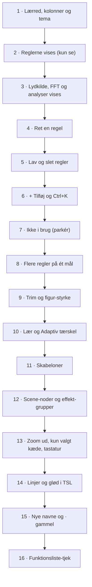

# Plan for Node-editoren

*6. november 2026 · skrevet af Claude Code ud fra papir v7.5 (`NODE-EDITOREN.md`) og koden i Claude MV v9.18 · opdateret efter svarene i papir v7.6*

Planen bygger Node-editoren (vores navn; fagudtryk: node editor) i små trin. Hvert trin bliver en ny version (v9.19, v9.20 …), kan testes og vises med skærmbilleder.

---

## A · Svarene (6. november 2026: "alt som anbefalet")

Spørgsmålene er besvaret i papir v7.6 (`docs/arkiv/BESKED-TIL-CODE-v7_6.txt`). Svarene gælder for alle trin.

| | Spørgsmål | Svar |
| --- | --- | --- |
| A1 | Billedmappen manglede | Ligger nu i `docs/node-editoren/` (17 billeder og `tema-warm-analog.json`) |
| A2 | Hvor skal Node-editoren være? | **En ny fane i Arbejdsfeltet** og **et nyt layout, "Noder"**, der gør den stor. Scenen kan stadig ses |
| A3 | Hvordan tegnes den? | **Noderne i HTML.** Linjer og glød først på et lærred (Canvas 2D, fagudtryk), skiftes til TSL (fagudtryk: Three.js Shading Language) i trin 14 |
| A4 | Nye navne | **I Node-editoren fra start.** Resten af programmet i trin 15. De interne nøgler ændres aldrig |
| A5 | Skrifttyperne | **Lægges ind i filen** (Orbitron, Exo 2, IBM Plex Sans), kun latinske og danske bogstaver |
| A6 | Versionsnumre | v9.19, v9.20 … for hvert trin. **v10.0 er den version, hvor de gamle vinduer fjernes** (efter trin 16, og kun når du siger til) |
| A7 | Ting uden plads i papiret | **Afsnit:** ny analyse-node (`hnd:drop`, `hnd:pause:*`, `hnd:sektion`). **Morph Pad:** blå node i Lydkilde-kolonnen, tæller ikke som lydkilde. **Tastatur:** lille blå node med Tast B ved siden af MIDI. **Tilfældigt** og **Kør Auto-mapping:** kommandoer i Ctrl+K. **Radial Mesh, EQ og Form-editoren** bliver ved, og deres regler dukker op i Node-editoren |
| A8 | Beskederne fra hovedchatten | Flyttet til `docs/arkiv/` |
| A9 | Flere scener ved siden af hinanden | **Til planen** (papirets afsnit 12). Bygges ikke nu |
| B1 | Analysernes udgange | **9 analyse-noder.** De 31 smalle bånd får deres egen node, **31 bånd**, med link fra FFT · fin. Spectral flux er en udgang på Slag-detektor. Klang har 12 udgange. Vokal bliver under Brede bånd. Tabellen står i papirets afsnit 5.4 |
| Ny | Tilføjelse til trin 4 | **Normalisering: Adaptiv · Fast** og **Samlet styrke** i værktøjslinjen |

**Der bygges et trin ad gangen, og først når du skriver "kør".**

---

## B · Svar på de åbne punkter (papirets afsnit 11)

Svarene er læst i koden for v9.18. Hovedchatten har skrevet dem ind i papir v7.6 (afsnit 5.4 og 11).

### B1 · Udgangene på analyse-noderne (afsnit 5.4)

Papirets syv analyse-noder med de udgange, koden har i dag. **Grundlag** fortæller, hvad målingen bygger på.

| Analyse-node | Udgange (navn i programmet · nøgle i koden) | Grundlag |
| --- | --- | --- |
| **Slag-detektor** | Kick · `kick` · Snare · `snare` · Hihat · `hihat` · Anslag i hele spektret (Spectral flux) · `flux` | FFT · hurtig (2048) |
| | Hændelse · slag, tone, støj · `hnd:klang:slag`, `hnd:klang:tone`, `hnd:klang:stoej` | en stigende kant i flux eller kick; typen bestemmes af flatness (over 0,45 = støj) og tonesikkerhed (over 0,6 = tone) |
| **Brede bånd** | Bas 20–250 Hz · `bas` · Mid 250–2k · `mid` · Høj-mid 2–6k · `hmid` · Brilliance 6–16k · `brill` · Vokal 200–900 Hz · `vokal` | FFT · hurtig (2048) |
| | **De 31 smalle bånd** (20 Hz til 20 kHz) · `ana:ls0` til `ana:ls30`, foldet sammen under de fire brede bånd (Bas 11, Mid 9, Høj-mid 5, Brilliance 6) | **FFT · fin (8192)**, ikke 2048 |
| | Dominerer: bas, mid, høj-mid, brilliance (eksperimentel) · `ana:domBas` osv. | regnes ud fra de fire brede bånd |
| **Tone og akkord** | De 12 toneklasser (Tone C til Tone B) · `ana:c0` til `ana:c11` · Toneklasse (C til B) · `ana:toneklasse` · Tonestyrke · `ana:tonestyrke` | FFT · fin (8192) |
| | Tonehøjde · `ana:pitch` · Tonesikkerhed · `ana:pitchsik` | McLeod-metoden (fagudtryk) på lydbølgen, direkte fra lydkilden |
| | Hændelse · akkordskift · `hnd:akkord` · Akkordens grundtone · `hnd:akkordrod` · Dur (0) eller mol (1) · `hnd:akkordmol` | de 12 toneklasser, sammenlignet med dur- og mol-akkorder |
| | Toneart (vises i bundbaren og Lydkilde) | hele sangen; **er ikke en kilde i dag** |
| **Klang** | Spectral centroid · `centroid` · Spectral flatness · `flat` · Spectral rolloff · `rolloff` (kun Niveau 4) | FFT · hurtig (2048) |
| | Zero crossing rate · `zcr` (kun Niveau 4) | lydbølgen, uden FFT |
| | Dissonans · `ana:dissonans` · Overtonerigdom · `ana:rigdom` · Ulige overtoner · `ana:ulige` · Spektral spredning · `ana:spredning` | FFT · fin (8192) og tonehøjden |
| | Energi · `ana:energi` · Lyshed · `ana:lyshed` | regnes ud fra RMS, flux, høj-mid, brilliance, centroid og rolloff |
| | Anslagsskarphed · `ana:anslag` · Legato-grad · `ana:legato` | regnes ud fra RMS |
| **Taktslag** | Taktslag · `ana:taktslag` · Takt (første slag) · `ana:takt` · Taktfase · `ana:taktfase` | fra filen: flux, kick, snare og hihat (FFT 2048) over hele sangen; mens det spiller: takturet |
| | Hændelse · taktslag, hvert 2. slag, hver takt, hver 2. takt · `hnd:takt`, `hnd:takt2`, `hnd:takt4`, `hnd:takt8` | samme som ovenfor |
| **Stereo** | Panorering · `ana:pan` · Stereobredde · `ana:bredde` · Faselighed · `ana:fase` | venstre og højre lydbølge, uden FFT; **kun lydfiler** |
| **Styrke** | RMS · `rms` | lydbølgen, uden FFT |
| | Peak, topamplitude (eksperimentel) · `ana:peak` | lydbølgen, uden FFT |
| **Afsnit** (ny i papir v7.6) | drop eller løft, musikken stopper, musikken starter, sektionsskift | RMS og afsnittene fra analysen af filen |

**Forslagene herunder blev til papir v7.6:** 9 analyse-noder, *31 bånd* er sin egen node, *Afsnit* er ny.
1. De **31 smalle bånd** kommer fra FFT · fin (8192), ikke FFT · hurtig. Enten får de en egen node (*31 bånd*) med link fra FFT · fin, eller *Brede bånd* får links fra begge FFT-noder.
2. **Spectral flux** er en udgang på *Slag-detektor*. Papiret nævner den ikke.
3. **Klang** har 12 udgange (flere end tegningen sikkert viser). Energi, Lyshed, Anslagsskarphed og Legato-grad regnes ud fra andre lydtræk.
4. **Vokal** står under *Brede bånd*. Den kunne også stå under *Tone og akkord*.
5. **Hver af de 14 lydtræk findes også pr. spor**, når der er 4 spor (fx *Kick · Trommer*). Sporene går direkte til lydtræk, som papiret siger. Analyserne (de 31 bånd, toner osv.) har kun den samlede lyd.

### B2 · Kan flere løsrevne scener ses på én gang i zone-tilstand?

**Nej, ikke ved siden af hinanden.** Det står i koden (ikke prøvet i browseren):

1. Når zone-tilstand starter, lægger `zonSamlUde()` alle løsrevne faner tilbage som faner i Scenen (blokken *v9.0: INTET LIGGER FRIT OVEN PÅ ZONERNE*).
2. *Riv løs* (`scRiv`) åbner i zone-tilstand fanen som et **panel ovenpå** (`zonPop`, klassen `zon-pop`).
3. `zonPop` lukker ikke andre paneler. Flere paneler kan altså være åbne på samme tid.
4. Men **alle paneler får den samme faste plads og størrelse**: 12 % fra venstre, 9 % fra toppen, 76 % bredde og 76 % højde, lag 250000 (CSS med `!important`). De kan ikke flyttes (træk i overskriften stoppes for `zon-pop`) og ikke gøres større eller mindre (`resize: none`).
5. Derfor **ligger to løsrevne scener præcis oven på hinanden**, og kun den øverste kan ses. Esc lukker den øverste, og så kommer den næste frem.
6. Rundt om panelet ligger en mørk skygge over resten af skærmen, så Scenen bagved er dæmpet.
7. Den eneste anden vej er **Send til skærm** (Projektor, `window.open`). Den åbner ét ekstra browservindue (altid det samme navn, `rytme-udgang`), så kun én kilde ad gangen.

**For Node-editoren betyder det:** "Én scene-node for hver scene, der vises" (afsnit 5.9) passer til i dag: én scene i Scenen-zonen, ét panel ovenpå og én på Projektor-skærmen. Flere scener ved siden af hinanden står i *Til planen* (svar A9).

---

## C · Faste regler for alle trin

| Regel | Sådan sikres den |
| --- | --- |
| **Gamle gemte indstillinger kan stadig åbnes** | Node-editoren gemmer sine egne ting i **nye felter** (fx `set.ne` og `ne` i en opsætning). Mangler et felt, bruges en standard, der regner **præcis som i dag**. De gamle felter (`maps`, `thr`, `gain` …) ændres ikke. Testen `12-gamle-indstillinger.js` (seks gamle versioner) kører i hvert trin, og i trin 1 lægges en **v9.18-indstilling** ind som den syvende. Hvert trin tjekker også, at `maps` er ens før og efter, at Node-editoren har vist dem. |
| **Ingen funktion fra FUNKTIONER.md forsvinder** | De gamle vinduer bliver, som de er, gennem hele planen. Trin 16 er en tabel, der sætter hver linje i `docs/arkiv/hjertet/FUNKTIONER.md` ud for sin plads i Node-editoren, og en test, der går tabellen igennem. **Et gammelt vindue fjernes kun, når du siger til** (afsnit 8 i papiret). |
| **Farver og glød kommer fra `tema-warm-analog.json`** | Programmet er én fil uden server, så temaet lægges ind i filen som `<script type="application/json" id="tema-warm-analog">` og læses derfra til CSS-variabler (fagudtryk: custom properties, fx `--ne-regel`) og til linje-laget. En test tjekker (1) at temaet i programmet er det samme som filen i `docs/node-editoren/`, og (2) at Node-editorens blokke **ikke indeholder én eneste farvekode** (`#…`, `rgb(`, `hsl(`). |
| **Ordet "link" i koden** | Mesh 3D bruger allerede `M3.links`. Node-editorens linjer hedder derfor noget andet i koden, fx `NE.linjer`. Alt nyt får forstavelsen `NE`. |
| **Reglerne er den samme liste som i dag** | Node-editoren viser og ændrer `maps`, ligesom Dublet, Router 2.0 og Mapping. En regel, der laves ét sted, står straks alle steder. Hver regel får et **fast id** (fagudtryk: unique id), så den kan findes igen; gamle regler uden id får et, når de åbnes. |
| **Fortryd** | Form-editoren har allerede Fortryd og Gentag for figurer og forbindelser (50 skridt, blokken *v4.8*). Node-editoren bruger **den samme historik**, så Ctrl+Z virker ens begge steder. |
| **Hvert trin** | ny version tre steder, nyt afsnit i manualen og linjen "Nyt i …", ny testfil `tests/14-node-editor-…js`, hele testpakken grøn, skærmbilleder til dig, og ærlig besked om det, der ikke er testet. |

---

## D · Trinene

Tallene i *Version* forudsætter, at hvert trin bliver én version. Er et trin for stort, deles det.

| Trin | Version | Hvad der bygges | Det kan du se og prøve bagefter | Test (trin 4 i testpakken) |
| --- | --- | --- | --- | --- |
| **1 · Lærred, kolonner og tema** ✅ lavet | v9.19 | Fanen *Node-editor* i Arbejdsfeltet og layoutet *Noder* i topbjælken. Temaet indlæses fra JSON. Skrifttyperne lagt ind i filen. Et tomt lærred med de 9 kolonner (Ikke i brug, Lydkilde, FFT, Analyse, Lydtræk, Regel, Figur, Mål, Scene) med overskrifter i kolonnefarverne, bredder 200, 320 og 440, afstand 120. Værktøjslinjen med kun zoom og *Tilpas*. Kontrolpanelet nederst med teksten "Klik på en node for at se, hvordan den virker." | Fanen åbner. Du ser de varme kolonnefarver. Du kan zoome med musehjulet og flytte lærredet ved at trække. | fanen åbner uden fejl; temaet i filen = `docs/node-editoren/tema-warm-analog.json`; ingen farvekoder i Node-editorens blokke; v9.18-indstillingen åbner; skærmbillede |
| **2 · Reglerne vises (kun se)** ✅ lavet | v9.20 | Noderne for **Lydtræk → Regel → Figur → Mål** og linjerne mellem dem bygges ud fra `maps`. Fælles opbygning (overskrift 40 punkter, mærker, skærm, tal, bundlinje, porte). Levende målere. Situationerne Normal, Valgt, Flyttes, Venter, Slukket. Klik viser **sætningen** i kontrolpanelet (fx "Når kick er over 0,60, hopper Pige 2.") og **signalet over tid**. Noder kan flyttes; pladsen gemmes. **Intet kan ændres endnu.** | Åbn *Pigernes show*: alle regler står som noder med linjer, der lyser i takt. Klik på en regel og læs sætningen. Flyt en node; den bliver, hvor du satte den, efter genstart. | antal regel-noder = antal forbindelser for hver forudindstilling (`FORINDST`); `maps` er uændret bagefter; gammel indstilling uden `ne` placeres automatisk; skærmbilleder |
| **3 · Lydkilde, FFT og analyser vises** ✅ lavet | v9.21 | **Lydkilde** (lydfil med bølgeform, to målere, navn, længde, tempo, toneart; 4 spor med én række pr. spor; Lyd ind; Generator med genre, tempo og tæthed; MIDI). **FFT · hurtig** og **FFT · fin** med liggende spektrum. De **9 analyse-noder** (Slag-detektor, Brede bånd, 31 bånd, Tone og akkord, Klang, Taktslag, Stereo, Styrke, Afsnit) med udgangene fra papirets afsnit 5.4. De blå noder **Morph Pad** og **Tastatur** ved siden af MIDI. Situationerne Analyserer (med procent), Sover, Ikke tilgængelig (fx "Vælg 4 lydfiler"). Klik på bølgeformen hopper i sangen. | Træk en mp3 ind: du ser procenten, så bølgeformen og spektrene. Følg vejen fra lydfilen gennem FFT og analysen til en regel. | alle udgange fra B1 findes som porte; mono- og stereo-testfil; 4 spor (testens stems); generator; skærmbilleder |
| **4 · Ret en regel** ✅ lavet | v9.22 | **Handling ▾ / Egenskab ▾.** Tærsklen trækkes på måleren (gul streg, hysterese lige under). Styrken trækkes i tallet. Kontrolpanelet: hele kæden (vend om, tærskel og hysterese, kurve, gain, attack og release, spærretid, hold, slew), **Standard**, **Gate** og Gate-tærskel (i dag *Port* og *Portgrænse* i Mapping), Auto-valg for Taktslag og Spor, **Styrke brugt** med hele regnestykket. I værktøjslinjen: **Normalisering: Adaptiv · Fast** og **Samlet styrke**. Mærkerne "Vendt", "Gate · åben/lukket". Fortryd med Ctrl+Z og ↶ ↷, kort besked efter hver ændring (fagudtryk: toast). | Ret tærsklen på en regel, og se den samme ændring i Mapping og Router 2.0. Fortryd den. | hver indstilling ændrer det samme felt i `maps` som Mapping og Router; regningen i motoren er uændret for de samme tal; Fortryd; skærmbilleder |
| **5 · Lav og slet regler** ✅ lavet | v9.23 | Træk en linje ud fra et lydtræk og slip på et tomt sted → en lille liste med kun det, der passer → reglen lægges, hvor du slap → træk videre til en figur → menu med figurens mål (mangler målet, laves det). Ny regel starter med Standard. **Slå fra / Slå til** (fagudtryk: bypass) og **Slet**. | Lav en ny regel fra Kick til en figur med musen alene. Slå den fra, og se den slukket. Slet den, og fortryd. | de 7 forløb fra papirets afsnit 6, nr. 1, 2 og 6; reglen findes i `maps` og i Mapping; skærmbilleder |
| **6 · + Tilføj og Ctrl+K** ✅ lavet | v9.24 | **+ Tilføj** under hver kolonne. **Ctrl+K** (findes allerede som Søg fra v9.16) får to grupper: *Tilføj node* (typefarve og lille levende bar) og *Knapper*. En node fra Ctrl+K lander nederst i sin kolonne, og kortet flytter sig derhen. Kommandoerne *Ryd hold*, *Ryd tomme mål*, *Tilfældigt* og *Kør Auto-mapping*. | Tryk Ctrl+K, skriv "hihat", og læg et lydtræk ind. Kortet flytter sig derhen, og noden lyser kort. | Ctrl+K finder både noder og de gamle knapper; Auto-mapping fortrydes i ét trin; skærmbilleder |
| **7 · Ikke i brug (parkér)** ✅ lavet | v9.25 | Kolonnen *Ikke i brug*: træk en kilde, en analyse eller et lydtræk derhen. Reglerne **sover**, hvor de står (tonet ned og stiplet), med stiplede linjer fra en lille grå udgang. Træk tilbage, og de sovende regler vågner. Beskeden "Alt vil sove. Parkér alligevel?" ved den eneste kilde. Nyt felt for at sove; mangler det, er reglen vågen. | Parkér Kick, og se figuren holde op med at hoppe. Træk Kick tilbage, og den hopper igen. | forløb 7; en regel, du selv har slået fra, bliver slukket; gamle indstillinger åbner med alle regler vågne; skærmbilleder |
| **8 · Flere regler på ét mål** ✅ lavet | v9.26 | Mål-noden: **Største** (standard, som i dag), **Læg sammen** (højst 1) og **Gang** (fagudtryk: max, add, multiply). Mærket står, når der er mere end én regel. Tomt mål: "Ingen regler". **Kræver en lille ændring i motoren**; uden valg regner den præcis som før (i dag tager den altid den største). | Læg to regler på samme mål, og skift mellem Største og Læg sammen. Se forskellen på måleren. | Største giver præcis de samme tal som v9.18; Læg sammen og Gang regnes rigtigt; skærmbilleder |
| **9 · Trim og figur-styrke** | v9.27 | **Trim** på lydtræk (−12 til +12 dB) og **styrke på figurer og effekt-grupper**. Begge **findes ikke i dag** og bygges i motoren. Styrke brugt bliver regel × figur × samlet styrke × følsomhed × afsnits-dynamik. Normaliseringen vises i kontrolpanelet ("−18 dB → Adaptiv → 0,82"). Situationen **rammer loftet** (rødt topmærke). | Skru trim op på et svagt lydtræk, og se det nå loftet. Skru en figurs styrke ned, og se alle dens regler blive svagere. | standard 0 dB og 100 % giver præcis de samme tal som v9.18; Styrke brugt viser alle led; skærmbilleder |
| **10 · Lær og Adaptiv tærskel** | v9.28 | **Lær** (ét tryk): en sang bruger analysen af hele sangen, Lyd ind lytter i 8 sekunder. Handling: tærsklen sættes lige under de tydelige slag. Egenskab: mindst og mest sættes. Besked med Fortryd, fx "Tærskel sat til 0,58 ud fra 212 slag". **Adaptiv tærskel** får to skydere i kontrolpanelet: hvor hurtigt (1–8 s, standard 3 s) og bundgrænse (0–0,3, standard 0,05). I dag er tallene faste i koden. | Tryk Lær på en ny regel, og se tærsklen flytte sig. Fortryd. | Lær på testlyden (120 BPM) giver en tærskel under slagene; standardværdierne regner som i dag; skærmbilleder |
| **11 · Skabeloner** | v9.29 | 4–6 skabeloner fra start (fx Dans på trommer, Diskokugle på bas, Klodsbane på slag, Arme på vokal, Morgenstjerne). Slip en skabelon på en figur. Findes lydtrækket allerede, bruges det igen. Kan figuren ikke få målet, springes reglen over med en besked. Markér regler og vælg **Gem som skabelon**. | Slip *Dans på trommer* på en figur, og se reglerne komme. Fortryd fjerner alle på én gang. | skabelon fortrydes i ét trin; et mål med en regel i forvejen får "Største"; skærmbilleder |
| **12 · Scene-noder og effekt-grupper** | v9.30 | **Scene-noder** med et lille levende billede (få billeder i sekundet), kun for de 5 scener (Live preview, Radial Mesh, Mesh 3D, Øjet, Lyd i 3D). Klik åbner scenen stort; *Riv løs* og *Send til skærm* i kontrolpanelet; **Slukket** stopper tegningen. **Effekt-grupper** (Dublets 5 grupper) som blå noder med øje, Slå fra og styrke. **Baggrund ▾** i værktøjslinjen. | Se Live preview som et lille billede i noden. Sluk Mesh 3D, og se den holde op med at tegne. | Mesh 3D og Øjet starter stadig; slukket scene tegner ikke; skærmbilleder |
| **13 · Zoom ud, kun valgt kæde, tastatur** | v9.31 | Under 20 % zoom bliver noderne til lys uden tekst (fagudtryk: level of detail). **Kun valgt kæde** (fagudtryk: isolate) og **Dæmp**. **Tastaturet**: piletaster, Home/End, Enter, Delete og Esc, som i Dublet og Routing-overblik. | Zoom helt ud, og se lysene. Vælg en kæde, og se resten blive dæmpet. Lav en regel uden mus. | forløb 3 og 4; tastatur-forløb; skærmbilleder |
| **14 · Linjer og glød i TSL** | v9.32 | Den nye three.js (fast version) lægges ind ved siden af r128 i et eget `<script type="module">` (valg A fra trin 0). Linjer og glød tegnes i TSL med WebGPU og WebGL2 som reserve. Glød kun på det valgte og det, der slår til lige nu. Filen bliver cirka 3,7 MB større. | Det samme som før, men linjerne lyser blødere. Intet andet ændrer sig. | Mesh 3D og Øjet virker uændret; reserven WebGL2 starter; **WebGPU kan ikke testes her** (intet grafikkort); skærmbilleder |
| **15 · Nye navne og "· gammel"** | v9.33 | Navnene fra papirets afsnit 2 i hele programmet og i manualen (fx Adaptiv tærskel, Opsætning 1–20, Auto-mapping, Gate). De fire gamle vinduer får "· gammel" bag navnet: Dublet, Router 2.0, Routing-overblik og Mapping. De interne nøgler ændres ikke. | Alle steder står de nye navne. De gamle vinduer virker stadig. | gamle pladser A–T åbnes som Opsætning 1–20; manual-testen; søg efter de gamle navne giver 0; skærmbilleder |
| **16 · Funktionsliste-tjek** | v9.34 | En tabel i `docs/` med hver linje fra FUNKTIONER.md og dens plads i Node-editoren, og en test, der går tabellen igennem. **Kort over forbindelserne** (Mermaid, PNG, SVG) og de **11 visninger i Routing-overblik** står med; dem, der ikke er lavet, står som "mangler". | Du kan se, hvad der mangler, før et gammelt vindue må fjernes. | testen går alle linjer igennem; **intet gammelt vindue fjernes** uden din besked |

---

## E · Det, der ikke er med i planen

- Alt i papirets afsnit 12 (*Til planen*): rigtig EQ som node, Lær ved at trykke i takt, flere lydkilder på samme tid, MIDI-knapper og drejeknapper, opdeling i spor inde i MV osv.
- At **fjerne** de gamle vinduer. Det besluttes efter trin 16 og bliver v10.0 (svar A6).
- Flere scener ved siden af hinanden (svar A9).
- At flytte **Mesh 3D og Øjet** til den nye three.js (valg B i `STATUS.md`).

## F · Risici, jeg kender

| Risiko | Hvad jeg gør |
| --- | --- |
| Mange levende målere gør programmet langsomt | én opdatering for alle noder (højst 30 gange i sekundet), kun for de noder, der kan ses |
| Testbrowseren har intet grafikkort (SwiftShader) | trin 1 til 13 er HTML og et enkelt lærred; TSL kommer først i trin 14 (svar A3) |
| Reglerne har ikke et fast id i dag (de findes ud fra deres plads i listen) | **Ændret i trin 2:** for at `maps` kan forblive helt uændret, huskes en regels plads ud fra *kilde\|mål\|nummer*. Det faste id kommer i trin 4, når reglerne kan ændres i Node-editoren |
| Fortryd i Form-editoren gemmer et skridt efter 0,8 sekunder uden ændringer | Node-editoren bruger den samme historik; store ændringer (skabelon, Auto-mapping) gemmes straks som ét skridt |
| Programfilen vokser (skrifttyper cirka 0,2 MB, three.js cirka 3,7 MB) | skrifttyperne kun med de bogstaver, vi bruger; three.js først i trin 14 |
