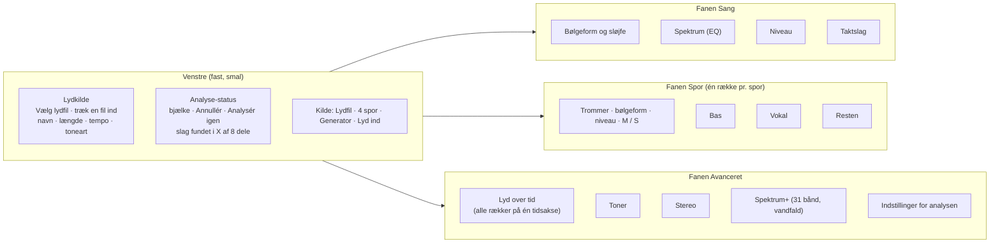

# PLAN · SANG OG ANALYSE · P8.4

17. november 2026 · udkast 1 skrevet af Claude Code efter brugerens besked 17. november; **P8.4: brugerens svar på de 10 spørgsmål er skrevet ind** (beskeden ligger i `docs/arkiv/BESKED-TIL-CODE-17-nov-P8_4.txt`) · **intet i denne plan er bygget** (ud over trin S0) · S1 bygges, når brugeren skriver "kør S1"; S2–S6 som en ny pakke efter pakke 4.

Hører til `PLAN-NY-BRUGERFLADE.md` (P8.3), fase 5, arbejdsområdet **1 · Sang**.

---

## 0 · Kort fortalt

| Spørgsmål | Svar |
| --- | --- |
| Hvad er ønsket? | En opdateret Lydkilde-menu og et nyt **avanceret layout til musik-analyse** ("lyd over tid" og andre nyttige indstillinger), med de tre billeder af *AURA Studio · Waveform Pro* som inspiration. Ikke for meget dobbelt. |
| Hvad er problemet i dag? | Analysen af en sang på 74 minutter tager cirka 10 minutter. Det, der måles, ligger i fem vinduer (Lydkilde, Tidslinje, Analyse, EQ, EQ+) og i Node-editoren, og noget vises flere steder. |
| Hvad foreslår planen? | (1) Analysen regnes i baggrunden og på flere kerner, så den bliver hurtigere og ikke får programmet til at hakke. (2) Arbejdsområdet Sang får **kort** (vores navn; et kort = én måling med sin tegning og sine tal), som i billederne. (3) En ny visning **Lyd over tid** (vores navn): alle målinger på én fælles tidsakse for hele sangen. (4) Fire nye målinger: lydstyrke (LUFS), dynamisk område, goniometer og klip-tæller. |
| Hvad foreslår planen **ikke**? | Mixer, Master EQ, kompressor og limiter, der ændrer lyden (se afsnit 4). Kort, der kun er pynt (billedernes "DEMO · VISUALISERING"). |
| Hvad er lavet nu? | Trin S0 (v9.68): bjælke og Annullér. **Trin S1 (v9.70): baggrunds-tråde, brug sangen imens, flueben pr. del.** |
| Hvad er besluttet (P8.4)? | Ingen mixer (A + B). Tre faner: **Sang · Spor · Avanceret**. Fart: baggrunds-tråde og brug sangen imens (a + c). LUFS og dynamisk område kun som visning. Indstillingerne for analysen står i Sang. HPSS og spilleliste venter. Antal spor skrives ikke fast i koden. Rækkefølge: S1 først (på "kør S1"), S2–S6 efter pakke 4. |

---

## 1 · Reglen mod dubletter

> **Én måling, ét kort.** Hver måling har ét sted i Sang, hvor den vises og stilles. Kortet viser **den samme talrække, som reglerne bruger** (ikke en ny beregning ved siden af).

Det følger af Grundreglen (intet er skjult) og af D2 (intet lægges sammen). Konkret:

- Et kort må ikke regne sit eget tal. Det læser fra analysen (`F`, `A`) eller fra den levende lytter, som motoren også bruger.
- Viser et kort noget, der kan bruges i en regel, står lydtrækkets navn på kortet (fx *Faselighed*), og kortet har knappen **Brug i en regel**, der åbner matrixen med rækken.
- En ny måling, der næsten er den samme som en gammel, bliver **ikke** et nyt lydtræk. Eksempel: lydstyrke (LUFS, kort tid) følger RMS meget tæt. Den vises på kortet Niveau, men kommer ikke i listen over lydtræk, medmindre du beder om det.
- Billedernes mærker *LIVE · RIGTIG ANALYSE* og *DEMO · VISUALISERING*: i MV findes kun rigtige målinger. Et kort, der ikke kan måle noget endnu, vises ikke.

---

## 2 · Billedernes kort, sammenlignet med MV i dag

Billederne ligger i `docs/sang-og-analyse/` (`inspiration-1-enkelt-spor.png`, `inspiration-2-multi-spor.png`, `inspiration-3-master.png`).

| Nr. i billedet | Kort i billedet | Fagudtryk | Findes i MV i dag | Forslag |
| --- | --- | --- | --- | --- |
| 01 | Bølgeform og loop-region | waveform, loop A/B | **Ja:** Tidslinje (bølgeform, afsnit, drop) og A/B-sløjfen i bundbjælken | **Flyt:** ét kort *Bølgeform og sløjfe*. A/B-sløjfen flytter hertil, når bundbjælken fjernes (trin 5b) |
| 02 | Frekvensspektrum | spectrum analyzer | **Ja:** EQ (søjler med tærskler), EQ+ (31 bånd, topværdi), FFT-noderne i Node-editoren | **Behold:** kortet *Spektrum* er EQ. EQ-visningens grafik ændres ikke (planens afsnit 5) |
| 03 | VU-måler V/H med peak, RMS og klip | VU meter, peak, RMS, clip | **Delvis:** V/H i dB på Lydfil-noden; RMS og peak som lydtræk. Ingen klip-tæller | **Nyt kort** *Niveau*: V/H, topmærke (peak hold), klip-tæller |
| 04 | Spektrogram (vandfald) | spectrogram, waterfall | **Delvis:** EQ+ har Vandfald (kun de sidste sekunder); Analyse har log-spektrum | **Nyt:** spektrogram for **hele sangen** i Lyd over tid (afsnit 3). EQ+'s Vandfald bliver |
| 05 | LUFS: integreret, true peak, range, short-term | loudness (ITU-R BS.1770) | **Nej** | **Nyt** på kortet *Niveau*: fire tal og en kurve over tid. Kun visning (se regel 1) |
| 06 | Stereobillede | goniometer, vektorskop | **Delvis:** tallene Stereobredde og Panorering findes; ingen tegning | **Nyt kort** *Stereo*: tegningen (goniometer) plus de to tal, der findes |
| 07 | Fase-korrelation | phase correlation | **Ja:** lydtrækket Faselighed | **Flyt** ind på kortet *Stereo* som en kurve over tid |
| 08 | Dynamisk område | dynamic range, crest factor | **Nej** | **Nyt** på kortet *Niveau*: crest factor (top minus RMS i dB) og dynamisk område for hele sangen |
| 09 | Tonehøjde og toneklasser | pitch, chroma | **Ja:** Analyse (toneklasser, tonehøjde, de 12 toner), toneart | **Flyt:** kortet *Toner* er Analyse-vinduet |
| 10 | Taktslag og tempo | beat grid, BPM | **Ja:** tempo, taktslag, takt, takturet; ½×, 2× og Tap ligger i Show-vinduet | **Flyt:** kortet *Taktslag* med ½×, 2× og Tap (i dag gemt i Show) |
| 11 | Harmonisk mod perkussiv, og høj/lav-deling | HPSS, STFT | **Nej** (står i Idé-kassen) | **Senere, dit valg** (trin S7). Tung beregning; giver to nye kilder: *Toner uden trommer* og *Trommer uden toner* |
| – | Spilleliste til venstre | playlist | **Nej** (står i Idé-kassen) | **Senere, dit valg** (trin S8) |
| – | Fanen Multi-spor: 8 spor med fader, pan, M og S | stems, mute, solo | **Delvis:** 4 spor (Trommer, Bas, Vokal, Resten) i kortet *4 spor* i Lydkilde | **Fanen 4 spor:** én række pr. spor med bølgeform, niveau og **M / S til at lytte** (se afsnit 4) |
| – | Mixer, gruppe-fadere, kanalstriber | mixer, channel strip | **Nej** | **Anbefaling: nej** (afsnit 4) |
| – | Fanen Master: EQ med 6 bånd, kompressor, limiter, stereobredde | mastering chain | **Nej** (EQ+ har *Lyt til ét bånd*) | **Anbefaling: nej** (afsnit 4) |

**Optælling:** af billedernes 11 kort har MV 5 helt, 3 delvist og 3 slet ikke.

---

## 3 · Lyd over tid (vores navn)

Det, du kalder "lyd over tid". I dag kan du kun se én ting over hele sangen: bølgeformen i Tidslinje (og lydtrækkene i Node-editorens visning Tidslinje). Forslaget er **én fælles tidsakse** med rækker, du slår til og fra:

| Række | Hvad den viser | Hvor tallene kommer fra |
| --- | --- | --- |
| Afsnit og drop | farvede blokke (intro, vers, drop …) | analysen (findes) |
| Bølgeform | lydens udsving, V og H | lydfilen (findes) |
| Spektrogram | frekvens op ad, tid hen ad, farve = styrke | de 31 bånd (findes; tegnes ikke for hele sangen i dag) |
| Lydstyrke | kurve i LUFS, kort tid | ny måling |
| Taktslag | streger for slag og takt 1 | analysen (findes) |
| Toner | de 12 toner som bånd | analysen (findes) |
| Stereo | bredde og faselighed som kurver | analysen (findes) |
| Lydtræk efter eget valg | fx Kick, Bas, Vokal som kurver med reglens tærskel som streg | de samme rækker, reglerne bruger |

- Samme markør (hvor sangen er nu), samme zoom og samme A/B-sløjfe i alle rækker. Klik = hop i sangen.
- Zoom fra hele sangen ned til cirka 2 sekunder.
- Den sidste række gør det muligt at **se, hvorfor en regel slår til eller ikke gør**: kurven og tærsklen står oven på hinanden for hele sangen. Det havde vist fejlen med den lange sang med det samme.
- **Mulig dublet:** Node-editorens visning *Tidslinje* (under Visning ▾) viser også lydtræk over tid. Forslag: den fjernes, når Lyd over tid er bygget (spørgsmål 5).

---

## 4 · Skal MV kunne ændre lyden? (mixer, EQ, kompressor)

Billederne har en mixer, en Master EQ, en kompressor og en limiter. Det er værktøjer til at **lave om på lyden**. MV **måler** lyden og tegner efter den.

| Mulighed | For | Imod |
| --- | --- | --- |
| **A · Ingen ændring af lyden** (anbefalet) | Det, du hører, er det, analysen har målt. Ingen ny kæde af knapper. Passer til "ikke for meget dobbelt" | Du kan ikke rette en sangs lyd i MV |
| **B · Kun lytte-hjælp:** M / S pr. spor (4 spor) og *Lyt til ét bånd* (findes i EQ+) | Du kan høre, hvad et spor eller et bånd indeholder, mens du laver regler. Analysen røres ikke | Lyden, du hører, er i den tid ikke den, reglerne ser (det skal stå tydeligt på skærmen: "Du lytter kun til Trommer") |
| **C · Fuld mixer og master-kæde** som i billederne | Ligner et lydprogram | Mange nye knapper (billedet: cirka 60). Analysen passer ikke længere til det, du hører, medmindre den regnes om ved hver ændring. Et andet program (fx din DAW, fagudtryk for lydprogram) gør det bedre |

**Valgt (P8.4): A + B.** Mixer og master-kæde bygges ikke. Når der kun lyttes til et spor eller et bånd, skal det stå tydeligt på skærmen.

---

## 5 · Layoutet i arbejdsområdet 1 · Sang

### 5.1 Muligheder

| Mulighed | Beskrivelse | For | Imod |
| --- | --- | --- | --- |
| **A · Én lang side med alle kort** (som billede 1) | Alle kort under hinanden; man ruller | Alt kan ses uden klik | Lang side (billedet er cirka 3 skærme højt); det meste bruges sjældent |
| **B · Tre faner: Sang · Spor · Avanceret** (valgt, P8.4) | *Sang* har de 4 kort, du bruger mest. *Avanceret* har resten og Lyd over tid. *Spor* har sporene (én række pr. spor, uanset hvor mange) | Let at gå til, dybt når du vil (Grundreglen: detaljer må foldes sammen). Ligner billedernes tre faner | Et klik mere til de avancerede kort |
| **C · Behold de fem vinduer, og læg kun de nye kort til** | Mindst arbejde | Dubletterne bliver; fem vinduer plus nye |

### 5.2 Opdelingen (B, valgt i P8.4)

| Fane | Kort | Kommer fra |
| --- | --- | --- |
| **Sang** | Bølgeform og sløjfe | Tidslinje + A/B-sløjfen |
| | Spektrum | EQ |
| | Niveau (V/H, top, klip, lydstyrke, dynamisk område) | nyt |
| | Taktslag (tempo, ½×, 2×, Tap, takt) | bundbjælken + Show-vinduet |
| **Spor** | én række pr. spor: bølgeform, niveau, M / S. **Antallet skrives ikke fast i koden** (P8.4): fanen tegner én række pr. spor, der findes, så Lydtidslinjen senere kan give fx 6 spor (trommerne delt i kick, snare, toms og bækkener). Når der kun lyttes til ét spor eller ét bånd, står det tydeligt på skærmen (fx "Du lytter kun til Trommer") | kortet *4 spor* i Lydkilde |
| **Avanceret** | Lyd over tid | nyt |
| | Toner (toneklasser, tonehøjde, toneart) | Analyse |
| | Stereo (goniometer, bredde, panorering, faselighed) | nyt + tal, der findes |
| | Spektrum+ (31 bånd, vandfald, topværdi, Lyt til ét bånd) | EQ+ |
| | Indstillinger for analysen | Automatik-panelet (Normalisering, Lange sange, Adaptiv tærskel) – **står i Sang; Automatik viser kun en linje med "ændres i Sang"** (P8.4) |

### 5.3 Indstillinger, der kunne være nyttige (kortet *Indstillinger for analysen*)

| Indstilling | Hvad den gør | Findes |
| --- | --- | --- |
| Normalisering: Adaptiv · Fast | hvordan tallene skaleres | ja (Automatik) |
| Lange sange: i stykker | lokalt niveau for sange over 10 minutter | ja (Automatik); stykkets længde (2 min) kan ikke stilles i dag |
| Adaptiv tærskel: Til · Fra, fart, bundgrænse | tærsklen følger sangen | ja (EQ og Automatik) |
| Analysér igen | regner sangen om | ja (Automatik) |
| **Nøjagtighed: Hurtig · Normal · Fin** | hvor tæt målingerne ligger i tid (se afsnit 6) | nyt |
| **Analysér kun et udsnit** | fx kun sløjfen A til B, når du prøver noget af | nyt |
| **Tempo-område** (fx 60–180) | hjælper taktslag-analysen, når den vælger halvt eller dobbelt tempo | nyt (i dag ½× og 2× bagefter) |
| **Ryd gemte analyser** | sletter cachen (i dag kan en gammel analyse kun fjernes ved at analysere igen) | nyt |
| **Flueben: hvad der analyseres** (brugerens ønske 17. november) | et flueben pr. del af analysen, fx *Lydtræk (bas, slag, styrke)*, *Toner og tonehøjde*, *De 31 bånd*, *Stereo*; det, der er slået fra, regnes ikke, og dets kilder står som *Ikke analyseret* i matrixen og Node-editoren. Det sparer tid på lange sange (trin 2 er cirka 81 % af tiden). Standard: alt slået til. Regler, der bruger en kilde, som er slået fra, giver 0 og siger hvorfor | nyt (hører til S1 eller S2; se afsnit 6) |

---

## 6 · Analysens fart

**Målt hos dig:** 74 minutter tog cirka 10 minutter. **Målt i koden:** analysen har to trin. Trin 1 (lydtræk: FFT 2048) er cirka 19 % af tiden. Trin 2 (toner og klang: FFT 8192, de 31 bånd) er cirka 81 %. Begge kører i dag i samme tråd som skærmen (fagudtryk: main thread), i små bidder med pauser, så skærmen kan følge med.

| Mulighed | Hvad | For | Imod |
| --- | --- | --- | --- |
| **a · Baggrunds-tråde** (fagudtryk: Web Worker), én pr. kerne i din computer | Sangen deles i stykker, og hvert stykke regnes i sin egen tråd | Skærmen hakker ikke. Med fx 8 kerner **skønnet 4–6 gange hurtigere** (74 min på cirka 2 minutter). Samme tal som i dag | Skal prøves i en fil uden server (tråden laves fra tekst i filen; det plejer at virke i Chrome og Edge, men er ikke prøvet her). Tallene i kanten mellem to stykker skal være præcis de samme som i dag (test mod den gamle analyse) |
| **b · Nøjagtighed: Hurtig** for lange sange | Trin 2 måler halvt så tit | Cirka dobbelt så hurtig, let at lave | Toner og bånd får grovere tid (46 ms i stedet for 23 ms); tallene er ikke helt de samme |
| **c · Brug sangen, mens resten regnes** | Trin 1 er færdigt efter cirka en femtedel af tiden; afspilning og regler på lydtræk virker da. Toner og bånd kommer til, når trin 2 er færdigt | Du venter cirka 2 minutter i stedet for 10, før du kan gå i gang | Regler på toner og de 31 bånd giver 0, indtil trin 2 er færdigt (skal stå tydeligt) |
| **d · Gør ingenting** | – | – | 10 minutter |

**Valgt (P8.4): a + c.** b kun, hvis a ikke kan lade sig gøre i en fil uden server. **Brugerens tilføjelse (17. november):** analysen deles i dele med et flueben pr. del, så man kan fravælge det, man ikke bruger (tabellen i 5.3). Det kommer med i S1 som en simpel liste i Automatik-panelet (flyttes til kortet i Sang i S2).

**Ærligt:** tallene "4–6 gange" og "2 minutter" er et skøn ud fra antal kerner. De er ikke målt. Testmaskinen har ingen rigtig lang sang og få kerner.

---

## 7 · Trinene

Hvert trin får sit eget versionsnummer, sin egen test og sit eget gem, som i pakkerne. Hvert trin fjerner noget (planens regel).

| Trin | Hvad bygges | Hvad fjernes | Afhænger af |
| --- | --- | --- | --- |
| **S0** (lavet, v9.68) | Bjælke med trin, procent, tid gået og tid tilbage; knappen Annullér | – | – |
| **S1** (**lavet i v9.70**) | Analysen i baggrunds-tråde (6a) og *brug sangen, mens resten regnes* (6c); flueben pr. del af analysen i Automatik. Test 65: samme tal som den gamle analyse (største forskel 0). Målt i testmaskinen med 3 tråde: 5 minutters lyd 25 s → 10 s; brugerens 74 minutter er ikke målt | pauserne i den gamle analyse (den gamle vej findes stadig som reserve, hvis tråde ikke kan laves) | – |
| **S2** (**lavet i v9.76**) | Sang som faner og kort (5.2) med **kun det, der findes** i dag, flyttet ind: vinduet Sang (w35), Lydkilde til venstre, fanerne Sang · Spor · Avanceret; Indstillinger for analysen står i Sang, Automatik siger "Ændres i Sang". Test 71 | vinduerne Tidslinje, Analyse, EQ og EQ+ som selvstændige vinduer (5 vinduer bliver til 1); ½×, 2×, Tap i Show | 5b (bundbjælken) eller samtidig |
| **S3** (**lavet i v9.77**) | Lyd over tid (afsnit 3) som kort under Avanceret: Afsnit, Bølgeform, Spektrogram, Taktslag, Toner, Stereo og lydtræk med tærskler; rækkerne er en liste (`LOT.rk`), så Lydtidslinjens rækker kan lægges til senere | Node-editorens visning Tidslinje (ja, P8.4) | S2 |
| **S4** | Kortet Niveau: klip-tæller, lydstyrke (LUFS), dynamisk område | V/H-målerne på Lydfil-noden bliver en kopi af kortet (samme tal) | S2 |
| **S5** | Kortet Stereo: goniometer og kurver | – | S2 |
| **S6** | Fanen Spor: én række pr. spor og M / S til at lytte | kortet 4 spor i Lydkilde | S2 |
| **S7** (vent, P8.4) | Harmonisk og perkussiv deling (HPSS) som to nye kilder | – | S1 (tung beregning) |
| **S8** (senere, P8.4) | Spilleliste | – | S2 |

**Plads i pakkerne (valgt, P8.4):** S1 for sig selv, når brugeren skriver "kør S1". S2–S6 som en ny pakke efter pakke 4 (5b, 5c), fordi S2 bygger på, at bundbjælken er væk. S7 og S8 i Idé-kassen, til brugeren siger til.

---

## 8 · Spørgsmålene og brugerens svar (P8.4, 17. november)

| Nr. | Spørgsmål | Anbefaling | **Svar** |
| --- | --- | --- | --- |
| 1 | Skal MV kunne ændre lyden (mixer, Master EQ, kompressor)? | Nej. Kun M / S pr. spor og Lyt til ét bånd (afsnit 4: A + B) | **Nej. A + B.** Når der kun lyttes til et spor eller et bånd, skal det stå tydeligt på skærmen |
| 2 | Layout: én lang side (A), tre faner (B) eller som nu (C)? | B | **B** (fanerne Sang · Spor · Avanceret) |
| 3 | Fart: baggrunds-tråde (a), grovere måling (b), brug sangen imens (c)? | a + c | **a + c**; b kun, hvis a ikke kan lade sig gøre i en fil uden server |
| 4 | Skal lydstyrke (LUFS) og dynamisk område også være **lydtræk**, man kan lave regler på? | Nej, kun visning (de følger RMS tæt) | **Kun visning** |
| 5 | Må Node-editorens visning Tidslinje fjernes, når Lyd over tid findes? | Ja | **Ja** |
| 6 | Indstillingerne for analysen: i Sang (kortet) eller i panelet Automatik? De må kun stå ét sted | I Sang; Automatik viser en linje med "ændres i Sang" | **I Sang**; Automatik viser kun linjen "ændres i Sang" |
| 7 | HPSS (trin S7): ønsket? Du har allerede 4 spor fra Ultimate Vocal Remover, som er bedre end HPSS til trommer og vokal | Vent | **Vent** |
| 8 | Spilleliste (trin S8): ønsket nu eller senere? | Senere | **Senere** |
| 9 | Rækkefølge: S1 (fart) nu, eller først pakke 4? | S1 først | **S1 først** (på "kør S1"). Pakke 4 venter på, at brugeren har set arbejdsområderne |
| 10 | Billedernes 8 spor: MV har 4 (Trommer, Bas, Vokal, Resten). Skal der kunne være flere? | Nej | **Byg kun 4 nu, men skriv ikke "4" fast i koden.** Fanen tegner én række pr. spor, uanset hvor mange, og må hedde **Spor** |

### 8.1 · Navne (begge er vores egne navne, P8.4)

| Navn | Hvad |
| --- | --- |
| **Lyd over tid** | skærmen, der viser sangen på én tidsakse (afsnit 3) |
| **Lydtidslinjen** | en fil med lydenes hændelser (planen under *Senere*). Når den kommer, bliver den til **ekstra rækker i Lyd over tid**, ikke en ny visning. Lyd over tid bygges, så der senere kan lægges rækker med hændelser til (streger for kick, noder, ord) |

## 10 · Senere (ikke en del af trinene; P8.4)

- **Lydtidslinjen** og **Lydanalyse-kort v1.0** fra hovedchatten (https://claude.ai/artifact/DWwBZLPvvZ43gVJbDiYwBA). Første trin derfra: kør hele analysen (tonehøjde, toner, klang) på **hvert spor**, især tonehøjden på Vokal-sporet. Bygges først, når S1 er lavet, fordi det giver cirka fem gange så meget at regne. **Intet fra dette punkt bygges nu.**

---

## 9 · Ikke testet og usikkert

- Baggrunds-tråde fra en fil uden server er ikke prøvet i MV. Kan det ikke lade sig gøre, falder S1 tilbage til 6b og 6c.
- Farten i afsnit 6 er skøn, ikke målinger.
- Lydstyrke efter ITU-R BS.1770 kræver et filter (K-vægtning) og en port (gating); tallene skal sammenlignes med et kendt program, før de kaldes LUFS på skærmen.
- "True peak" kræver, at lyden regnes op i 4 gange så mange punkter (fagudtryk: oversampling). Det er tungt for 74 minutter; måske kun for det stykke, der vises.
- Et spektrogram for 74 minutter med de 31 bånd bruger tal, der allerede ligger i hukommelsen (191.000 målinger × 31 bånd, cirka 24 MB); billedet af det fylder cirka 6 MB. Et finere spektrogram (fx 256 bånd) ville fylde cirka 50 MB som billede og er ikke med i planen.
- Billederne er læst som skærmbilleder; knapper, der ikke kan ses på dem, er ikke med i sammenligningen.
- Planen siger ikke, hvordan kortene skal se ud (farver, skrift). Det hører til trin 5c (ét tema i hele programmet).
