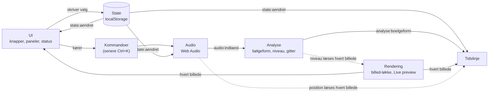

# Rytme Studio · fremskridt

Rytme Studio er et nyt program, bygget fra bunden efter en specifikation (ikke ud fra koden til Claude MV). Det bygges over **5 runs**. Denne fil holder styr på, hvad der er færdigt, og hvad det næste run tager. **Læs den først, når et nyt run begynder.**

- **Programmet:** `rytme-studio/rytme-studio.html` (én fil; åbn den direkte i browseren).
- **Test:** `node rytme-studio/tests/koer-alle.js` (cirka 2 minutter). Skærmbilleder lander i `rytme-studio/tests/ud/` (gemmes ikke i repoet).
- **Skærmbilleder af det nyeste run:** `rytme-studio/skaermbilleder/`.

## Status

| Run | Indhold | Status |
| --- | --- | --- |
| **1** | Layout, afspiller, bølgeform-tidslinje, filer, status, niveau-måler, fire opsætninger, tre stile | **Færdig** (21. november 2026, version 0.3) |
| 2 | Hele analysen, vist live i preview og kontrolpanel; baggrunds-tråde | Næste |
| 3 | Figurer (former, lag, egenskaber, generator) og enkel mapping | |
| 4 | Node-editor, regler og regel-sæt, opsætninger, scene-grundlag | |
| 5 | Resten af visningerne, fuld skærm, output-vindue, kvalitet, Ctrl+K, hjælp, polering | |

## Run 1: det, der er bygget

- **Layout:** topbar (navn, status, sprog), sidebar (arbejdsområder og lydfil), stort Live preview, tidslinje, kontrolpanel til højre, playerbar i bunden. Mørkt blågråt; **turkis = målt lyd**, **rav = tid** (afspilningsstreg, loop, snap). Virker fra 600 til 3840 punkters bredde.
- **Afspiller:** afspil, pause, stop, søg (tidslinje, skyder, piletaster), lydstyrke, lyd fra, loop af hele sangen, loop A til B (uden hak).
- **Tidslinje:** oversigt over hele sangen og et udsnit, der kan zoomes (musehjul, skyder, + og −) fra hele sangen til 4000 punkter pr. sekund. Snap til slag eller takt. Følg afspilning. Loop markeres med Shift + træk; håndtagene A og B kan trækkes.
- **Tempo-gitter:** tempo som tal eller med Tap, slag pr. takt, Takt 1 her. Manuelt i Run 1; Run 2 måler tempoet.
- **Filer:** vælg fil, slip fil i vinduet, flere filer på én gang, liste over det, der er åbnet i denne omgang, tydelig fejl ved en fil, der ikke kan afkodes. Demo-lyd på 120 BPM, lavet i programmet.
- **Niveau:** RMS og top i dB (måler i kontrolpanelet, cirkel i preview). Måles før lydstyrken.
- **Status:** én linje i topbaren; klik viser de seneste beskeder. Alle fejl ender dér.
- **Husker:** lydstyrke, sprog, følg og snap; og pr. sang (navn + længde) loop og tempo. Gemt i browseren (localStorage).
- **Sprog:** dansk og engelsk. **Genveje:** står i kontrolpanelet under Genveje.

## Udseendet er valgt (21. november 2026)

Brugeren har godkendt **runde 2** i `kladder/` (se `kladder/KLADDER.md`): én samlet stil efter arket *Delene*, og hvert arbejdsområde med sin egen opbygning (Afspiller: billede i ramme · Analyse: baner · Figurer: kanaler · Regler: matrix · Show: afsnit). **Næste skridt, når brugeren skriver "kør":** byg programmet om til den stil (det erstatter de fire opsætninger og tre stile herunder), og fortsæt så med Run 2.

## Fire opsætninger (version 0.3; brugeren vælger)

Skiftes i topbaren (Opsætning) og huskes. Det er de samme dele, lagt forskelligt med CSS Grid (`html[data-layout="…"]`); ingen kode er dobbelt.

| Opsætning | Sådan ligger vinduerne | God til |
| --- | --- | --- |
| **Studie** | sidebar til venstre, preview over tidslinjen i midten, kontrolpanel til højre, playerbar i bunden | alt på én gang |
| **Scene** | preview fylder hele vinduet; sidebar (folder sig ud under musen), tidslinje, playerbar og kontrolpanel (knappen Panel eller P) svæver ovenpå | at se billedet stort |
| **Tidslinje** | afspiller øverst, stor tidslinje i fuld bredde, forneden et bånd med sidebar, lille preview og kontrolpanelet i tre søjler | at arbejde i rytmen (loop, snap, senere klodser) |
| **Fliser** | arbejdsområderne som faner øverst; preview, Niveau, Lydfil, Loop og Tempo-gitter er hver sin flise; tidslinje og playerbar i bunden | overblik; nye ting kan få deres egen flise |

Under 1181 punkters bredde bruges den smalle opsætning for alle. **Åbent:** brugeren har ikke valgt endnu.

## Tre stile (version 0.2; brugeren vælger)

Skiftes i topbaren (Stil) og huskes. Alle tre er rigtige, kørende temaer; de kan alle blive som valg under Tema.

| Stil | Udtryk | Bølgeform | Live preview |
| --- | --- | --- | --- |
| **Glas** | roligt blågråt, glas og glød; turkis lyd, rav tid | udfyldt flade | glaskugle |
| **Neon** | dyb violet, farveforløb fra cyan til pink, runde former; gul tid | søjler | lysende ring med stråler (de sidste 20 sekunder) |
| **Analog** | varmt udstyr: taster, fadere, skruer, lysdioder; rød tid | udfyldt flade i creme og guld | VU-meter med viser og top-lampe |

En stil er CSS (`html[data-stil="…"]`) plus modulet `stil` (farver og former til lærrederne). **Åbent:** brugeren har ikke valgt endnu.

## Sådan er koden delt op

Ét globalt navn, `RS`. Hvert modul er sit eget script-element (`data-modul`) og kan senere flyttes til sin egen fil.

Fuld streg = besked (`RS.Events`). Stiplet = værdi, der læses i billed-løkken, fordi den ændrer sig hele tiden.

| Modul | Opgave |
| --- | --- |
| `kerne` | `RS`, `RS.util`, `RS.Events` (beskeder mellem modulerne) |
| `i18n` | tekster på dansk og engelsk |
| `stil` | de tre stile: farver, bølgeformens form og figuren i Live preview |
| `state` | indstillinger i localStorage; loop og tempo pr. sang; `snapshot` og `gendan` (grundlag for presets) |
| `kommandoer` | alt, brugeren kan gøre: id, titel, genvej, funktion |
| `audio` | indlæs, afspil, pause, stop, søg, loop, lydstyrke, demo-lyd |
| `analyse` | Run 1: bølgeform i lag, niveau (RMS og top), tempo-gitter, snap, Tap |
| `rendering` | billed-løkken med delta-tid; Live preview |
| `tidslinje` | bølgeform-tidslinjen |
| `ui` | alle HTML-elementer; registrerer kommandoerne |
| `start` | sætter modulerne i gang; fanger alle fejl |

Kommer: `RS.Mapping` (Run 3) og `RS.Scene` (Run 3 og 4).

## Valg, jeg har truffet i Run 1 (kan laves om)

| Valg | Hvorfor | Pris |
| --- | --- | --- |
| Hele sangen afkodes til hukommelsen (AudioBuffer) | præcis søgning og loop uden hak; analysen i Run 2 skal alligevel bruge alle tal | cirka 21 MB pr. minut stereo |
| Bølgeformen males som et billede og kopieres | 54 billeder i sekundet ved 3840 × 2160 i testbrowseren (før: 22) | cirka 40 MB ved 3840 punkters bredde |
| Niveauet måles før lydstyrken | billederne skal ikke ændre sig, når man skruer ned | |
| Ruller man selv, slås Følg afspilning fra | ellers trækker udsnittet tilbage | det står i status, og knappen viser det |
| Tempo-gitteret er manuelt | snap skal virke allerede nu | Run 2 gør det til Auto eller Manuel |
| Navne på funktioner er danske, modulerne hedder som i specifikationen | samme stil som Claude MV | |
| Én fast fil (`rytme-studio.html`), version i titlen | det er et andet program end Claude MV | reglen om nyt filnavn pr. version bruges ikke her |

## Planen for Run 2 til 5 (alt fra specifikationen har en plads)

**Run 2 · Analyse:** egen FFT og AnalyserNode · RMS, top, spectral centroid, rolloff, flux, zero-crossing · 7 frekvensbånd · chroma (12 toneklasser) · F0 og klarhed · slag: kick, snare, hihat, onset · tempo (BPM) med sikkerhed og oktav-håndtering, som fylder tempo-gitteret (Auto eller Manuel) · stereo · dele til og fra · baggrunds-tråde med fremskridt og fallback · lokal normalisering · vurdering af analysens kvalitet · live-analyse · arbejdsområdet Analyse · lydgenerator (enkle beats og toner; også facit for analysen) · forsinkelsen fra lydkortet (outputLatency) regnes med.

**Run 3 · Figurer og enkel mapping:** figurer med op til 6 lag · former (cirkel, kugle med pigge, terning, danser, discokugle, morgenstjerne med flere) · egenskaber (størrelse, skala, rotation, position, farve HSL, glød, tekstur, perspektiv, dybde) · figur-generator · liv (attack og decay, glitter, ekko, usikkerhed) · synlighed, skabeloner, listen På scenen · lydtræk → egenskab med styrke · kontrolpanelet skifter efter valgt figur · 4 spor (stems) som kilder.

**Run 4 · Node-editor og opsætninger:** lærred med noder og forbindelser (linjer med glød) · regler med styrke, fra og til, gate, stiplet, søvn · regel-sæt (Rolig, Energisk, På trommerne, På vokalen, Hele bandet) · multi-styring, solo, mærk preview · Foreslå regler · opsætninger (standard, indbyggede, egne 1–20) · eksport og import som JSON · scene med flere elementer.

**Run 5 · Resten:** Radial Mesh · Mesh 3D (three.js, én udgave) · EQ og EQ+ · bane og klods · effekter (flash, partikler, skyer, dæmpringe, ekko) · Øjet · fuld skærm · output-vindue · wakeLock · optagelse, projektor, sort skærm · kvalitet og ydelse · Ctrl+K (kommandolisten findes allerede) · hjælp · tema og feltfarver · lås layout · niveau (enkel og avanceret) · MIDI · detektions-tuning · show-tilstand.

## Ikke prøvet endnu

- En rigtig skærm med grafikkort (din 43" i 3840 × 2160). Testbrowseren har intet grafikkort.
- Lyden er ikke hørt af et menneske (kun målt: positionen løber, og niveauet er der).
- At trække en fil ind fra skrivebordet (testen efterligner hændelsen).
- Sange over cirka 15 minutter (hukommelse), andre browsere end Chromium, berøringsskærm.
